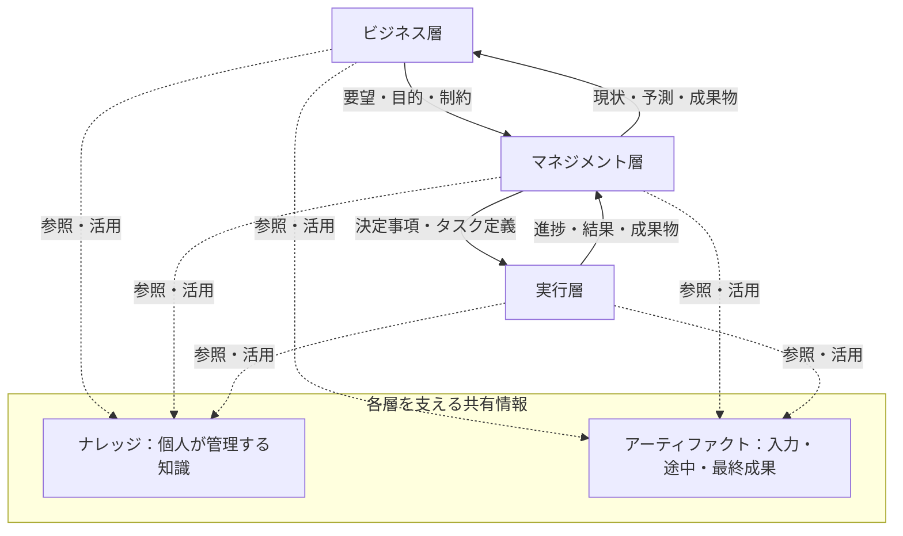

# ACTモデル 詳細解説

**Agentic, Context-driven Teamwork**  
直訳：エージェント主体の、コンテキスト駆動のチームワーク  
**AI主体・コンテキスト重視のプロジェクト運営モデル**

## 概要

ACT（アクト）は、エージェントAIが主体となって働くプロジェクトを、**責任と決定権の三層構造**と、**判断・実行に使う情報の整理**によって運営するモデルです。

ビジネス層が目的と制約を定め、マネジメント層が計画とタスクに変換し、実行層が条件内で方法を選んで仕事を進めます。結果はマネジメント層に戻り、現状と予測に整理されて、ビジネス層の次の判断につながります。

各層では、人間またはその代理となるエージェントAIが活動します。AIは原則として操作する人間と同じ権限を持ちます。活動を支える情報は、個人が管理する**ナレッジ**と、入力・途中結果・最終成果を扱う**プロジェクトアーティファクト**に分けます。

ナレッジは他のメンバーも閲覧できますが、更新できるのは所有者本人とその代理AIです。異なる知識が矛盾する場合は、利用する主体が目的・専門性・根拠・状況に応じて、採用する知識をその都度判断します。

### 本資料の対象と構成

本資料は、プロジェクトの事業責任者、マネージャー、実務担当者、およびAIを用いた業務運営を設計する人に向けて、ACTの構造と運用方法を説明します。

| 章 | 内容 |
| --- | --- |
| 第1〜3章 | 基本コンセプト、構成要素、全体構造と情報の流れ |
| 第4〜6章 | 役割、権限、自律性、人間とAIの関係 |
| 第7〜9章 | ナレッジとアーティファクト、更新・採用ルール、正式な決定との関係 |
| 第10章 | 四つの具体例 |
| 第11〜12章 | 情報設計の実装ガイドと、混同しやすい点 |
| 第13〜14章 | 導入時に定める事項と、運用を始める手順 |
| 第15章 | 用語集 |

ACTの基本ルールと、案件に応じた具体的な運用設計は区別します。第11章の記録項目は実装上の参考構成であり、特定のツールやデータ形式を必須とするものではありません。

## 1. ACTの基本コンセプト

### 1.1 定義

**ACTは、エージェントAIが主体となって働くプロジェクトにおいて、判断と実行に必要な情報（コンテキスト）の整理を中心に据えたモデルです。**

ビジネス・マネジメント・実行の三層に責任と決定権を分け、それぞれが上位の決定と矛盾しない範囲で自律的に活動します。

各層の活動を、次の二つの情報要素が横断して支えます。

- **ナレッジ**：判断・実行・解釈に使う知識。
- **プロジェクトアーティファクト**：入力として受け取り、作業で使い、作成・更新し、成果として扱う具体物。

人間とエージェントAIは、これらの役割と情報を使ってプロジェクトを進める主体です。

### 1.2 なぜ情報の整理を重視するのか

AIに「この作業を進めて」と依頼するだけでは、判断に必要な前提が不足することがあります。例えば、次のような情報です。

- この仕事で達成したい目的は何か。
- すでに決まっていることと、まだ検討中のことは何か。
- どこまで自分で判断してよいか。
- どの資料・データ・版を使うか。
- 誰の知識を、どの根拠で採用するか。
- 何をもってタスク完了とするか。
- 問題が発生した場合、誰の判断が必要か。

ACTでは、こうした情報を役割・決定・タスク・ナレッジ・アーティファクトの関係として整理します。これにより、人間が暗黙に理解していた前提を、AIが判断や実行に使える形で扱おうとします。

### 1.3 モデルが扱う範囲

ACTは、プロジェクトを運営するための次の関係を定義します。

- 目的・計画・実行を担う役割と、それぞれの決定権。
- 上位の決定を守りながら、自律的に仕事を進める範囲。
- 人間と、その代理として働くエージェントAIの関係。
- ナレッジの所有・閲覧・更新・採用のルール。
- 作業に使う具体物と成果物を、アーティファクトとして扱う考え方。
- 実行結果を次の判断へ戻す情報の流れ。

個々の作業に用いる開発手法、分析手法、プロジェクト管理ツール、AI製品は固定しません。これらは、目的や制約に合わせて選択します。

ACTの狙いは、役割に応じた自律性を持たせながら、判断の根拠と権限の境界を、人間にもAIにも理解できる形にすることです。

### 1.4 ACTが整理する三つの問い

| 問い | 対応する層 | 主な内容 |
| --- | --- | --- |
| 何を目指すのか | ビジネス層 | 目的、期待する価値、優先順位、制約 |
| 何を決め、どの仕事に分けるのか | マネジメント層 | 計画、決定事項、タスク定義、進捗評価、調整 |
| どう実現するのか | 実行層 | 方法選択、調査、分析、設計、実装、検証 |

実行層にも判断があります。三層は「考える人」と「手を動かす人」の区別ではありません。

### 1.5 ACTという名前が表すコンセプト

**ACT（アクト）**は、**Agentic, Context-driven Teamwork**の頭文字です。直訳は「エージェント主体の、コンテキスト駆動のチームワーク」です。

| 文字 | 語 | 本モデルで表すこと |
| --- | --- | --- |
| A | Agentic | エージェントAIが、代理する人間の権限の範囲で判断し、主体となって仕事を進める |
| C | Context-driven | 目的・制約・決定事項・ナレッジ・アーティファクト・現状を、判断と実行の根拠にする |
| T | Teamwork | 人間とAIが役割を分担し、要望・決定・進捗・結果を受け渡して協働する |

ACTの「A」はAgenticを表し、このモデルではエージェントAIが主体となる働き方を意味します。自律的に動く範囲は、各役割の権限と有効な決定事項によって定まります。

英語の「act」には「行動する」という意味があります。ACTでは、実行層も与えられた条件を理解し、方法を選び、必要な補助タスクを追加するなど、自ら判断して行動します。判断はビジネス層やマネジメント層だけのものではありません。

三層の構造と情報管理のルールは、この働き方を実現するための仕組みです。ACTは、コンテキストを整えることで、各役割が権限内で自律的に判断・実行し、その結果を次の協働につなげることを目指します。

## 2. モデルを構成する要素

ACTの構造は、三つの異なる軸から捉えると理解しやすくなります。

| 軸 | 要素 | 表すもの |
| --- | --- | --- |
| 責任と決定権 | ビジネス層、マネジメント層、実行層 | 何を判断し、何に責任を持つか |
| 活動する主体 | 人間、エージェントAI | 誰がその役割の仕事を行うか |
| 活動を支える情報 | ナレッジ、プロジェクトアーティファクト | 何を根拠にし、何を使い、何を作るか |

### 2.1 役割と人間は一対一ではない

一人が複数の役割を担うことがあります。

例えば、マネージャーが計画を立て、その後に自分でコードを書く場合、同じ人がマネジメント層と実行層の仕事を行っています。

役割を分ける目的は、人数や肩書きを増やすことではありません。どの判断を、どの権限で行っているかを明確にすることです。

### 2.2 AIは第四の層ではない

エージェントAIは、三層のどこか一つに固定される存在ではありません。

- ビジネスオーナーの代理として、情報を整理し、事業上の判断に関わる仕事を行う。
- マネージャーの代理として、タスクを定義し、進捗を評価し、計画を調整する。
- 実行担当者の代理として、調査・実装・検証などを行う。

AIが実際に行える判断・操作の範囲は、そのAIが代理する人間の権限によります。

### 2.3 共有情報基盤も第四の層ではない

ナレッジとアーティファクトを扱う仕組みは、三層を横断して支えるものです。

「共有情報基盤」は論理的な概念であり、一つのツール、一つのデータベース、一つのフォルダーへの集約を必須とはしません。

また、共有することは、全員がすべての情報を自由に書き換えられることを意味しません。特にナレッジには、所有者本人のみが更新できるというルールがあります。

## 3. 全体構造と情報の流れ

### 3.1 全体図

以下は、責任層と共有情報の関係を示すMermaid図です。Mermaid対応のMarkdownビューアーで描画できます。非対応の環境でも、後続の表で同じ内容を確認できます。

各層は情報を参照し、権限の範囲で作成・更新します。ナレッジの更新権限は第8章、アーティファクトについて導入時に定める事項は第13章に記載します。

### 3.2 各方向で受け渡すもの

| 方向 | 受け渡す情報 | 受け手が行うこと |
| --- | --- | --- |
| ビジネス → マネジメント | 要望、目的、期待価値、優先順位、制約、判断 | 実行可能性を検討し、計画とタスクに変換する |
| マネジメント → 実行 | 決定事項、タスク定義、目的、優先順位、制約、完了条件 | 条件を確認し、方法を選び、実行する |
| 実行 → マネジメント | 結果、成果物、進捗、課題、残作業の見積もり、改善提案 | 計画への影響を評価し、調整・再計画・判断依頼を行う |
| マネジメント → ビジネス | 現状、予測、成果物、選択肢、判断依頼 | 価値と見通しを確認し、次の要望や判断を返す |
| 各層 ↔ 共有情報 | ナレッジ・アーティファクトの参照、活用、許された作成・更新 | 必要な情報を使い、新たに得た情報を蓄積する |

一つひとつのメッセージには方向がありますが、全体としては、要望・実行・報告・再判断の循環になります。

### 3.3 成果物を「渡す」とは

成果物の受け渡しは、必ずしもファイルをコピーしたり、保管場所を移したりすることではありません。

共有されたアーティファクトの対象と版を指定し、「これを結果として提出する」「この版を受け入れる」と通知する形でも表現できます。

資料の置き場所と、正式な提出・受入れ・決定という行為を分けて考えます。

## 4. 三層の定義と役割

### 4.1 ビジネス層

**定義：プロジェクトの目的・期待価値・要望・制約を示し、事業上の判断を行う層。**

主体となる役割を、**ビジネスオーナー（Business Owner）**と呼びます。

#### 主な活動

- 何を実現したいかを示す。
- どの価値を重視するかを決める。
- 優先順位や制約を示す。
- マネジメント層から現状・予測・成果物を受け取る。
- 必要に応じて、要望や条件、継続の判断を更新する。

#### 権限

**ビジネス層のアウトプットを決定する権限を持ちます。**

例えば、事業上の目的、期待する成果、重視する条件、この層で定めた予算・期限などの決定や変更を担います。

「ビジネスオーナー」は会社の所有者という意味ではなく、当該プロジェクトの事業上の意思決定を担う役割です。また、関係するステークホルダー全員をこの役割と見なすものでもありません。

### 4.2 マネジメント層

**定義：ビジネス上の要望を実行可能な目標・計画・タスクに変換し、実績と予測に基づいてプロジェクトを調整する層。**

主体となる役割は、**マネージャー（Manager）**です。

#### 主な活動

- 要望を実行可能な単位に分ける。
- 計画、優先順位、依存関係を整理する。
- 決定事項とタスク定義を実行層に渡す。
- 結果・進捗・課題を受け取り、影響を評価する。
- 自分の権限内で計画を調整する。
- ビジネス層に現状・予測・成果物・判断依頼を返す。

#### 権限

次の二つを持ちます。

1. **ビジネス層のアウトプットに矛盾しない範囲で、自律的に判断・活動する権限。**
2. **マネジメント層のアウトプットを決定する権限。**

ビジネス層が定めた目的や制約を変える必要がある場合は、その決定権を持つビジネスオーナーに判断を求めます。

### 4.3 実行層

**定義：合意した目的・制約・完了条件のもとでタスクを遂行し、成果物と実行状況を返す層。**

主体となる役割を、**実行担当者（ワーカー／Worker）**と呼びます。開発者だけでなく、調査・分析・設計・検証などを担う人も含みます。

#### 主な活動

- タスクの目的と条件を確認する。
- 条件内で具体的な実行方法を選ぶ。
- 調査、分析、設計、実装、検証を行う。
- 結果と品質を確認する。
- 進捗、課題、見積もり、改善案を返す。

#### 権限

**マネジメント層のアウトプットに矛盾しない範囲で、自律的に判断・活動する権限を持ちます。**

この権限には、**既存の決定事項や、マネジメント層が定義したタスクに影響を与えない範囲で、タスクを追加する権限**が含まれます。

ただし、定義済みタスクの対象、期待する成果、完了条件などを変更する必要がある場合は、マネージャーの判断が必要になります。

### 4.4 役割の一覧

| 役割 | 主な判断対象 | 自律性の境界 |
| --- | --- | --- |
| ビジネスオーナー | ビジネス層のアウトプット | 当該プロジェクトの事業上の意思決定として担う範囲 |
| マネージャー | 計画、決定事項、タスク定義など | ビジネス層のアウトプットと矛盾しないこと |
| 実行担当者（ワーカー） | 実行方法、条件内の補助タスク追加など | 上位の決定・定義済みタスクと矛盾しないこと |

各役割は、自分の決定権の範囲で活動します。担当範囲を超える変更は、その決定権を持つ役割へ判断を求めます。

## 5. 自律性と決定権の境界

### 5.1 基本原則

**下位の層は、上位の決定と矛盾しない範囲で、自分の役割の仕事を自律的に進めます。**

実行層が直接参照するのはマネジメント層のアウトプットですが、そのアウトプット自体もビジネス層の条件と整合している必要があります。

このため、実行時にも、仕事に関係する上位の目的・制約を把握できることが重要です。

### 5.2 決定済みの情報と検討中の情報

上位層のあらゆる発言や下書きを制約にすると、検討中の案まで下位層を拘束してしまいます。

運用上は、決定済みの情報と検討中の情報を識別できるようにし、次の基準で扱います。

> **下位層の判断の境界になるのは、上位層が正式に確定したアウトプットとする。**

| 情報の状態 | 扱い |
| --- | --- |
| 下書き、検討中の案、未確認の仮説 | 検討や解釈の材料として参照する |
| 正式に確定した目的・制約・決定事項・タスク定義 | 自律的に進める範囲の境界として扱う |
| 新しい知見に基づく変更案 | 必要な判断を経て、決定を更新する |

正式な確定の方法、記録場所、有効な版の特定方法は、導入先の運用ルールとして定めます。

### 5.3 タスク追加とタスク変更の区別

| 行為 | 扱い |
| --- | --- |
| 合意した条件内で、実装方法を選ぶ | 実行担当者の裁量で行える |
| 既存の決定やタスクに影響しない補助タスクを追加する | 実行担当者の裁量に含まれる |
| 定義済みタスクの対象や完了条件を変更する | マネージャーが判断する |
| ビジネス層が定めた期限・予算・目的まで変更する | ビジネスオーナーが判断する |

例えば、検証結果を集計する小さなスクリプトの作成でも、期限や既存タスクの条件を変えるなら、単なる補助タスク追加とは扱えません。

「小さな作業かどうか」よりも、「既存の決定・タスクへ影響するか」が境界です。

### 5.4 タスク追加の影響を確認する観点

実行担当者がタスクを追加するとき、次の観点で影響を確認する考え方ができます。

- 目的や対象範囲を変えないか。
- 期待する成果や完了条件を変えないか。
- 期限、費用、品質などの条件に影響しないか。
- 他のタスクや他の担当者の計画に影響しないか。
- 上位の決定事項と矛盾しないか。

具体的な判定基準や許容幅は、プロジェクトの条件に応じて定めます。影響を判断できない場合は、決定権を持つ役割に確認してから進める運用が考えられます。

### 5.5 兼任する場合

マネージャーが実装を担当しているときに、タスク定義を見直す必要が生じることがあります。

この場合、別の人への依頼を必須にする必要はありません。その人がマネージャーの決定権を持っているなら、その役割として変更を決定できます。

ただし、実行上の工夫と、管理上の正式な変更は区別して扱います。役割を兼任していても、ビジネス層の制約まで独断で変更できるわけではありません。

## 6. 人間とエージェントAI

### 6.1 エージェントAIの定義

**エージェントAIは、人間が担う各役割の代理として、さまざまな作業を行う主体です。**

基本的に、AIを操作する人間と同じ権限を持ちます。実行層の作業だけでなく、マネジメント層やビジネス層の仕事も対象になります。

### 6.2 権限の考え方

| 操作する人間が持つ権限 | その代理AIによる行為の整理 |
| --- | --- |
| 実行方法を選ぶ権限 | 同じ条件の範囲で方法を選び、作業を行う |
| マネジメント層のアウトプットを決める権限 | 上位条件の範囲で、計画・タスク定義などの判断を代理する |
| ビジネス層のアウトプットを決める権限 | ビジネス層の役割としての判断を代理する |
| 自分のナレッジを更新する権限 | 本人の代理として、そのナレッジを更新する |
| 他人のナレッジを閲覧する権限 | 閲覧・利用できるが、更新はできない |

AIに任せることによって、本人が持たない権限が増えるわけではありません。

ACTは、AIによるすべての判断・操作に対して、その都度の人間承認を一律には要求しません。個別の承認条件を設ける場合は、導入先の運用ルールとして明示します。

### 6.3 人間の役割

人間は、AIが行えない作業を実施し、新たなコンテキストを追加します。特に、次のような活動が含まれます。

- 顧客や関係者とのコミュニケーション。
- 現場での確認や、AIが直接行えない作業。
- 対話や経験で得た背景・意図・前提の追加。
- 新しい情報を踏まえた本人のナレッジの更新。

人間が得た情報は、例えば次のようにモデルへ戻ります。

| 人間が得たもの | モデルでの扱いの例 |
| --- | --- |
| 顧客が会議で話した内容 | 議事録というアーティファクトに記録する |
| その発言から理解した顧客の優先事項 | 本人のナレッジとして保持する |
| 正式に合意された条件変更 | 決定権を持つ役割のアウトプットとして確定する |

同じ会話から得られた情報でも、記録・理解・決定は別の意味を持ちます。

## 7. ナレッジとプロジェクトアーティファクト

### 7.1 ナレッジの定義

**プロジェクトにおける判断・実行・解釈に利用する、事実、前提、背景、判断理由、方法、教訓などの知識。**

ナレッジが答えるのは、次のような問いです。

- 何が分かっているか。
- 何を前提としているか。
- なぜそのように判断したか。
- どのように進めればよいか。

一般化された知識だけでなく、その顧客、そのデータ、その案件に固有の知識も含みます。

| 例 | 知識の種類 |
| --- | --- |
| この顧客は処理速度より監査対応を重視する | 顧客に関する理解・背景 |
| このデータには退会済み顧客が含まれていない | データの前提・解釈 |
| この方式を選んだ理由は既存システムの制約にある | 判断理由 |
| この文書形式では、そのままでは検索に失敗しやすい | 技術上の知見 |
| 前回は確認条件が曖昧で、受入れ時に手戻りが発生した | 教訓 |

ナレッジには、誤認、仮説、古くなった理解が含まれることもあります。所有者が管理していることと、その内容が正しいことは別です。

### 7.2 プロジェクトアーティファクトの定義

**プロジェクトで、入力として受け取り、参照・加工・作成し、途中結果や最終成果として扱う、具体的な情報や制作物。**

アーティファクトが答えるのは、次のような問いです。

- どの資料、データ、制作物を使うか。
- どの版を参照・更新するか。
- 何を作成し、何を提出するか。
- 下書きなのか、レビュー中なのか、承認済みなのか。

| 用途 | 例 |
| --- | --- |
| 入力 | 顧客の要望書、提供されたデータ、既存システムの仕様書 |
| 作業途中 | 設計書の下書き、試作コード、調査メモ、中間集計 |
| 検証・記録 | テスト結果、議事録、評価レポート、決定記録 |
| 最終成果 | 納品する報告書、完成したコード、製品 |

完成品だけを指す言葉ではありません。

### 7.3 両者の違い

| 観点 | ナレッジ | アーティファクト |
| --- | --- | --- |
| 中心となるもの | 知識・理解・前提・理由 | 受け渡し・更新・管理の対象となる具体物 |
| 主な使い方 | 判断、実行方法の選択、情報の解釈 | 入力、加工、制作、検証、提出 |
| 具体例 | 「この顧客は監査対応を重視する」 | その発言を記録した議事録 |
| 管理の観点 | 所有者、内容、適用範囲、根拠など | 識別子、所在、内容、版、状態など |
| 更新権限 | 所有者本人と、その代理AI | 対象・役割に応じて導入先で定める |

両者は、物理的なファイル形式によって分けるものではありません。同じ文書についても、「管理する具体物」と「そこから得られる知識」は分けて捉えられます。

### 7.4 関連づける例

1. 顧客との会議を議事録として保存する。これはアーティファクト。
2. 担当者が「顧客は回答速度より根拠の確認を重視する」と理解する。これはその担当者のナレッジ。
3. その理解の根拠として、議事録を関連づける。
4. 実行担当者のAIがそのナレッジを参照し、回答に根拠を表示する設計を検討する。
5. 設計書やコードを作成する。これらは新たなアーティファクト。

知識の抽出と、知識を活用した制作を通じて、二つの要素がつながります。

### 7.5 用途と状態は別の軸

「入力・中間成果・最終成果」は、その作業における用途です。「下書き・レビュー中・承認済み」は、その対象の状態です。

例えば、承認済みの分析報告書が、次の設計タスクでは入力になります。アーティファクトをどれか一つの用途に固定する必要はありません。

## 8. ナレッジの所有・更新・採用ルール

### 8.1 所有・管理

**各プロジェクトメンバーは、自分のナレッジを管理します。**

マネージャーであるか、開発者であるか、どの層の仕事を行っているかに関係なく、所有者ごとに管理します。

### 8.2 更新

**自分のナレッジを更新できるのは、自分だけです。**

本人が操作するAIによる代理更新も、本人による更新として扱います。他のメンバーや、その代理AIは更新できません。

| 行為者 | Aさんのナレッジの閲覧 | Aさんのナレッジの更新 |
| --- | --- | --- |
| Aさん本人 | できる | できる |
| Aさんの代理AI | できる | Aさんの代理としてできる |
| Bさん | できる | できない |
| Bさんの代理AI | できる | できない |
| Aさん以外のマネージャーやビジネスオーナー | できる | 役職を理由に更新することはできない |

### 8.3 閲覧・活用

他のメンバーのナレッジは閲覧でき、自分の判断や作業に利用できます。

閲覧できること、作業に利用できること、内容を更新できることは、それぞれ別の権限です。

### 8.4 矛盾する知識の併存

**複数のナレッジが矛盾していても、それらを一つに統一することを必須としません。**

例えば、マネージャーが「このPDFはそのまま取り込める」と考え、開発者が「今回の画像PDFには文字抽出が必要」と検証している場合、両方のナレッジが存在し得ます。

誰かが中央で常に唯一の正解へ統合する、という仕組みを前提にはしません。

### 8.5 利用する場面で採用を決める

ナレッジを使う主体が、その作業や判断にどれを採用するかを都度決めます。

採用時には、次のような観点を使って知識の適合性を評価できます。各観点の優先順位は、判断する内容や状況によって変わります。

| 観点 | 確認する内容 |
| --- | --- |
| 専門性 | その分野をよく理解しているか |
| 根拠 | 実測、検証、記録、直接確認などの裏づけがあるか |
| 対象への適合性 | 今回のデータ、顧客、条件に当てはまるか |
| 最新性 | 情報が現在の状況に合っているか |
| 接点 | 当事者や対象に直接接して得た情報か |

### 8.6 採用例

| 判断する内容 | マネージャーの知識 | 開発者の知識 | この例での判断 |
| --- | --- | --- | --- |
| 今回の画像PDFをそのまま扱えるか | 一般的にはPDFを取り込めるという理解 | 対象ファイルの検証では文字抽出が必要 | 対象を実際に検証した開発者の知識を採用 |
| 顧客が速度と監査対応のどちらを重視するか | 直近の面談で監査対応を優先すると確認 | 一般的な使い勝手から速度が最優先だと推測 | 直接確認したマネージャーの知識を採用 |

「技術なら常に開発者」「顧客なら常にマネージャー」という自動ルールではありません。その場で確認できる根拠と状況によって判断します。

### 8.7 採用した後の扱い

あるナレッジを採用しても、別のメンバーのナレッジは自動では更新されません。

- 採用した知識を、今回の作業に使う。
- 他者の知識を上書きしない。
- 根拠や検証結果を本人に伝えることはできる。
- 本人が新しい情報を確認し、自分のナレッジを更新することはできる。

併存を認めることは、誤りを永久に放置するという意味ではありません。更新する主体を所有者本人に保つというルールです。

## 9. ナレッジと正式な決定の関係

### 9.1 採用判断は、権限を増やさない

**ナレッジの採用と、正式な決定の変更は別の行為です。**

例えば、開発者の知見を採用して「文字抽出が必要」と判断しても、それだけで、期限・予算・タスク定義を変更してよいことにはなりません。

| 行為 | 判断の対象 |
| --- | --- |
| 技術的に妥当な知識を選ぶ | 何を根拠に実行・解釈するか |
| 定義済みタスクを変える | どの仕事を、どの条件で行うか |
| ビジネス上の制約を変える | どの価値・条件を優先するか |

知識の正しさを判断する権限と、計画や制約を変更する決定権を混同しません。

### 9.2 変更が必要になった場合

1. 実行担当者またはAIが、新しい知識・根拠を確認する。
2. 既存の決定事項やタスクへの影響を整理する。
3. 自分の権限内で対応できるなら、その範囲で進める。
4. タスク定義などを変更する必要があれば、マネージャーが判断する。
5. さらにビジネス層の条件を変更する必要があれば、ビジネスオーナーが判断する。
6. 変更された決定を、次の作業に使うコンテキストへ反映する。

変更申請の様式や、決定を記録・通知する仕組みは、導入先の運用に合わせて選択します。

### 9.3 アーティファクト更新とも区別する

設計書の下書きを書き換えることと、正式な仕様変更を決めることも別です。

文書が更新されたという事実だけでは、その内容が正式な決定になったとは限りません。どの情報が検討中で、どれが確定しているかを識別できることが必要です。

## 10. 具体例：社内FAQのAI検証

以下はモデルの理解を助ける架空例です。特定案件の事実ではありません。

### 10.1 ケースA：要望から実行、結果から次の判断へ

#### 場面

社内FAQについて、回答の根拠を確認できるAIを、限られた期間・予算で検証します。

| 段階 | 主体 | 行動 | 生まれる・使う情報 |
| --- | --- | --- | --- |
| 1. 目的を示す | ビジネスオーナー | 「根拠を確認できるFAQを検証したい」と伝え、対象・制約を定める | 要望、目的、制約、ヒアリング議事録 |
| 2. タスクを定義する | マネージャー | 対象資料、評価データ、期待する成果、完了条件を定義する | 計画、タスク定義、入力資料 |
| 3. 実行する | 実行担当者のAI | 関連するナレッジと資料を参照し、条件内で検索方法を選び、試作・評価する | コード、試作品、テスト結果 |
| 4. 結果を返す | 実行担当者のAI | 「通常文書では動いたが、画像PDFでは失敗する」と報告する | 結果、課題、残作業の見積もり |
| 5. 見通しを示す | マネージャーまたは代理AI | 追加対応の影響を評価し、現状・予測・選択肢を返す | 進捗報告、計画案、判断依頼 |
| 6. 次の判断をする | ビジネスオーナー | 「今回は通常文書を優先する」と判断する | 新たな決定、更新された条件 |

実行の結果は、マネジメント層で「プロジェクトとして何を意味するか」に変換され、ビジネス層の次の判断に使われます。

### 10.2 ケースB：矛盾するナレッジが見つかった

#### 二つのナレッジ

- マネージャー：「PDFはそのまま取り込めると思う」。
- 開発者：「今回の画像PDFは、実測では文字抽出が必要」。

#### 進め方

1. 実行担当者のAIが、両方のナレッジを閲覧する。
2. 対象ファイルと検証結果を確認する。
3. 今回の技術判断では、開発者のナレッジを採用する。
4. マネージャーのナレッジは書き換えない。
5. 文字抽出を追加するとタスク定義や見積もりに影響するため、マネージャーへ判断を求める。
6. マネージャーは上位の条件内で対応できるかを判断し、必要なタスク変更を決定する。
7. マネージャー自身が根拠を確認し、自分のナレッジを更新する。

ここでは「技術的な採用判断」「タスク変更の決定」「本人のナレッジ更新」という三つの行為が分かれています。

### 10.3 ケースC：実行中に補助タスクを追加したい

#### 追加したい作業

検証結果を集計するための、小さな補助スクリプトを作成したいと考えます。

| 条件 | 扱い |
| --- | --- |
| 対象・期待する成果・完了条件・期限などに影響しない | 実行担当者のAIが、本人の権限で補助タスクを追加して実行できる |
| 別部門の資料にも対応するため、対象と完了条件を変える | 定義済みタスクの変更として、マネージャーが判断する |
| 対応拡大により、ビジネス層が定めた予算・期限を超える | ビジネスオーナーの判断が必要になる |

追加作業の名称ではなく、どの決定に影響するかで判断先が変わります。

### 10.4 ケースD：同じ人が管理と実行を兼ねる

マネージャー自身が実装を担当し、自分のAIを使って作業する場合です。

| 活動 | そのときの役割 |
| --- | --- |
| コードの実装方法を選ぶ | 実行担当者 |
| 上位条件内で、タスク定義を変更する | マネージャー |
| 顧客から聞いた背景を、自分のナレッジに追加する | ナレッジの所有者 |
| ビジネス層が定めた期限の変更を求める | マネージャーとして、ビジネスオーナーに判断を求める |

人が同じでも、行為の意味と権限の根拠を区別できます。この例は、役割を兼任できるという基本ルールを説明したものです。

## 11. 情報設計の実装ガイド

この章では、ACTを実際の文書・データ・ツールに落とし込むための記録項目を示します。以下は**参考構成**です。案件の規模や作業内容に応じて項目を選び、必要なコンテキストを受け渡せる形にします。

### 11.1 タスク定義に持たせる項目

| 項目 | 記載すること | 目的 |
| --- | --- | --- |
| タスクの識別子・名前 | どの仕事か | 受け渡しと報告の対象を特定する |
| 目的 | なぜこの作業を行うか | 方法選択の判断基準にする |
| 対象範囲 | どこまでを扱うか | 意図しない範囲拡大を識別する |
| 入力 | 使う資料・データと、その版 | 参照対象を特定する |
| 期待する出力 | 何を作り、何を返すか | 成果を具体化する |
| 完了条件 | どの状態で完了とするか | 完了判断を合わせる |
| 制約 | 期限、費用、品質、方式など | 自律性の境界を示す |
| 関連する決定事項 | 従うべき上位の決定 | 判断の根拠をたどれるようにする |
| 関連するナレッジ | 参照するとよい知識 | 背景や方法を理解しやすくする |
| 担当する役割・人 | 誰が実行するか | 責任の所在を示す |

### 11.2 ナレッジに持たせる項目

| 項目 | 記載すること |
| --- | --- |
| 所有者 | このナレッジを管理・更新する人 |
| 内容 | 事実、理解、前提、判断理由、方法、教訓など |
| 適用範囲 | どの案件・顧客・データ・条件に当てはまるか |
| 根拠 | 議事録、実測結果、検証、直接確認など |
| 関連アーティファクト | 根拠となる具体物の対象・版 |
| 確認状態 | 確認済み、仮説、推測など |
| 更新日 | いつの情報か |
| 注意点 | 適用しない条件や、残っている不確実性 |

他者が参照したときに「誰が、何を根拠に、どの範囲で理解しているか」を判断できる形を意図しています。

### 11.3 アーティファクトに持たせる項目

| 項目 | 記載すること |
| --- | --- |
| 識別子・名称 | 対象を特定する情報 |
| 内容・所在 | 実体、保存場所、参照先 |
| 版 | 参照・更新・提出の対象となるバージョン |
| 作成者・更新者 | 誰が作成・更新したか |
| 作成日・更新日 | いつの内容か |
| 状態 | 下書き、レビュー中、承認済みなど |
| 関連タスク | どの作業の入力・途中結果・成果か |
| 関連する決定・知識 | 何に基づいて作られたか、何の根拠になるか |

作成者を記録することと、作成者以外の編集を禁止することは別です。アーティファクトの編集権限については、ナレッジの本人更新ルールをそのまま適用せず、別途定義します。

### 11.4 ナレッジを採用した理由の記録

矛盾するナレッジから選んだ場合、後から判断を理解できるよう、次を記録する方法が考えられます。

- どのタスク・判断で使ったか。
- どの所有者の、どのナレッジを採用したか。
- どの根拠や条件を重視したか。
- どの範囲に適用したか。
- 正式な決定・タスク変更が必要だったか。

記録の要否、詳細さ、保存場所は、プロジェクトの条件に応じて定めます。この記録は、後から採用判断の理由をたどるためのものであり、他者のナレッジを変更するものではありません。

## 12. 混同しやすい点

| 混同しやすい理解 | ACTでの整理 |
| --- | --- |
| ビジネス層・マネジメント層・実行層は、別々の人でなければならない | 役割は兼任できる |
| 実行層は、指示どおりに手を動かすだけ | 条件内で方法を選び、補助タスクを追加し、改善を提案できる |
| AIは実行層だけで使う | 各層の役割を代理できる |
| AIなら人間より広い権限で操作できる | 原則、操作する人間と同じ権限 |
| 共有情報は全員が自由に編集できる | ナレッジは所有者本人のみが更新できる |
| 管理職の知識が常に正しい | 用途、専門性、根拠、状況などによって利用時に判断する |
| 矛盾する知識は必ず統合・削除する | 併存を認め、利用時に選ぶ |
| ナレッジは一般化されたノウハウだけ | プロジェクト固有の理解や前提も含む |
| アーティファクトは完成した納品物だけ | 入力資料、下書き、中間成果も含む |
| 知識を採用したら、計画も自動で変わる | 計画変更には、その決定権が必要 |
| 設計書を更新すれば、正式な仕様変更になる | 資料更新と正式な決定は別 |
| 同じツールに情報を集めればACTになる | 重要なのは、役割・権限・情報の意味と関係を整理すること |

## 13. 導入時に定める運用事項

ACTは、役割と権限の基本関係、情報要素の区別、ナレッジの所有・更新・採用ルールを定めます。具体的な編集権限、決定の記録方式、複数担当者の分担などは、導入する組織やプロジェクトに合わせて設計します。

### 13.1 個別に定める事項

| 運用事項 | 定める内容 | 明確にする理由 |
| --- | --- | --- |
| アーティファクトの編集権限 | 誰がどの対象を作成・変更・削除できるか | ナレッジの所有者ルールとは別に、具体物の操作範囲を決めるため |
| アーティファクトの承認・版管理 | どの版を提出・受入れ・正式な対象とするか | 作業中の資料と確定した対象を識別するため |
| 決定の記録方法 | 何をもって確定とし、誰の決定としてどこに残すか | 人間とAIが、有効な決定と権限の所在を確認するため |
| 同じ役割を複数人が担う場合の分担 | 担当領域、決定権の分担、判断が競合した場合の扱い | 同じ対象への矛盾した決定を扱うため |
| タスク追加の影響判定 | 既存の決定やタスクに影響する条件、具体的な許容幅 | 自律的に追加できる範囲を共有するため |
| 必要に応じた個別承認条件 | 特定の判断・操作に追加の承認を設けるか | 各案件の要件を、代理AIにも分かる条件として示すため |

### 13.2 情報の共有と編集権限

ナレッジは、他者が閲覧・利用でき、所有者本人が更新するという基本ルールを維持します。

アーティファクトの編集権限は、対象や役割に応じて定めます。例えば、作業中の設計書を複数の実行担当者で編集する運用や、確定した成果物の変更に所定の手続きを設ける運用が考えられます。いずれも導入先で設計する具体的な運用です。

「共有されている」「作成者が記録されている」「正式に確定している」という状態だけから、編集権限を自動的に決めることはしません。

### 13.3 決定の確定と伝達

上位の決定を実行の境界として使うためには、対象となる決定の内容、決定した役割、有効な状態を確認できることが必要です。

運用設計では、次の問いに答えられるようにします。

- どの内容が正式に確定しているか。
- その内容を決定したのは、どの役割か。
- 新しい決定が、以前のどの決定を置き換えるか。
- 変更の影響を受けるタスクや担当者はどれか。
- 次に活動する人間・AIが、更新された決定をどう把握するか。

これらをどのツールや文書で実現するかは固定しません。

## 14. 運用を始める手順

以下は、ACTの構造をプロジェクトへ適用するための実践手順です。プロジェクト規模に応じて、同じ人が複数の役割を担い、記録を一つの文書にまとめることもできます。

### 14.1 役割と決定権を割り当てる

ビジネスオーナー、マネージャー、実行担当者を明確にします。兼任する場合も、それぞれの役割として決められる範囲を確認します。

複数人が同じ役割を担う場合は、担当する対象や決定範囲を分けるなど、個別の分担を定めます。

### 14.2 目的・価値・制約を共有する

ビジネス層が、目的、期待する価値、優先順位、制約を示します。確定した内容と検討中の内容を区別し、マネジメント層が参照できるようにします。

作業に関係する条件は、実行層にも伝わる形にします。

### 14.3 タスクへ変換する

マネージャーが、目的に沿って計画とタスクを定義します。入力、期待する出力、完了条件、制約を示し、実行担当者が方法を判断できるようにします。

仕事を細かく分けるだけでなく、各タスクがどの目的につながるかを確認できることが重要です。

### 14.4 情報を利用できる状態にする

各メンバーのナレッジを所有者が分かる形で管理し、他のメンバーから参照できるようにします。アーティファクトは、対象・所在・版・状態を確認できる形で管理します。

AIが仕事を始める際には、代理する人間、担当する役割、有効な決定事項、対象タスク、関係するナレッジ・アーティファクトを識別できる状態にします。

### 14.5 実行と報告を繰り返す

人間または代理AIが、条件の範囲内で実行します。結果、進捗、課題、残作業の見積もりをマネジメント層に返します。

マネージャーは、確認できた実績と今後の予測を分けて扱い、必要な調整を行います。権限を超える変更は、該当する決定権を持つ役割へ判断を求めます。

### 14.6 結果を次のコンテキストへ戻す

新たな知見は、所有者本人またはその代理AIがナレッジへ反映します。作成・更新したアーティファクトは、次のタスクで利用できる状態にします。

ビジネス層の新たな判断や、マネジメント層の計画変更も、次の活動で参照する情報へ反映します。

### 14.7 運用開始時の確認項目

| 確認対象 | 確認する問い |
| --- | --- |
| 役割 | 誰がどの役割を担い、何を決められるか |
| 代理AI | 誰の代理として、どの役割の仕事を行うか |
| 上位の決定 | どの目的・制約・決定事項が有効か |
| タスク | 入力、期待する出力、完了条件、制約を把握できるか |
| ナレッジ | 誰の知識かが分かり、本人だけが更新できるか |
| 採用判断 | 知識の根拠・対象・新しさを確認できるか |
| アーティファクト | 何を、どの版で使い、誰が操作できるか |
| 報告 | 実績、課題、予測を、どの役割へ返すか |
| 変更 | どの決定に影響するかと、判断する役割を特定できるか |

この手順は、特定の製品や開発方法に依存しません。ACTの基本関係を、プロジェクトに合った運用として実現するためのものです。

## 15. 用語集

| 用語 | 本資料での意味 |
| --- | --- |
| ACT | Agentic, Context-driven Teamwork。AI主体・コンテキスト重視のプロジェクト運営モデル |
| Agentic | エージェントAIが、役割の権限内で主体的に判断・行動すること |
| Context-driven | 整理されたコンテキストを、判断・実行の根拠にすること |
| Teamwork | 人間とAIが役割と情報の受け渡しを通じて協働すること |
| コンテキスト | 判断・実行・解釈に必要な目的、制約、決定、知識、資料、状況など |
| ビジネス層 | 目的、期待価値、要望、制約などを示し、事業上の判断を行う層 |
| マネジメント層 | 要望を計画・タスクに変換し、実績と予測で調整する層 |
| 実行層 | 条件内で方法を選び、タスクを遂行して結果と状況を返す層 |
| ビジネスオーナー | ビジネス層の主体となる役割 |
| マネージャー | マネジメント層の主体となる役割 |
| 実行担当者／ワーカー | 実行層の主体となる役割 |
| エージェントAI | 人間の各役割の代理として作業する主体 |
| ナレッジ | 判断・実行・解釈に使う知識。プロジェクト固有の知識を含む |
| プロジェクトアーティファクト | 入力、途中結果、最終成果として扱う具体的な情報・制作物 |
| タスク定義 | 実行すべき仕事の目的、対象、入力、出力、完了条件、制約などを示す情報 |
| 決定事項 | 決定権を持つ役割が決めた内容 |
| アウトプット | 各層の活動から外に渡す決定、定義、情報、結果、成果物など |
| 共有情報基盤 | 各層がナレッジやアーティファクトを利用するための論理的な仕組み |
| 自律性 | 上位の決定や定義済みタスクと矛盾しない範囲で、自ら判断・実行できること |
