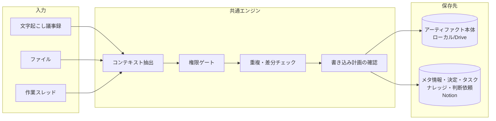
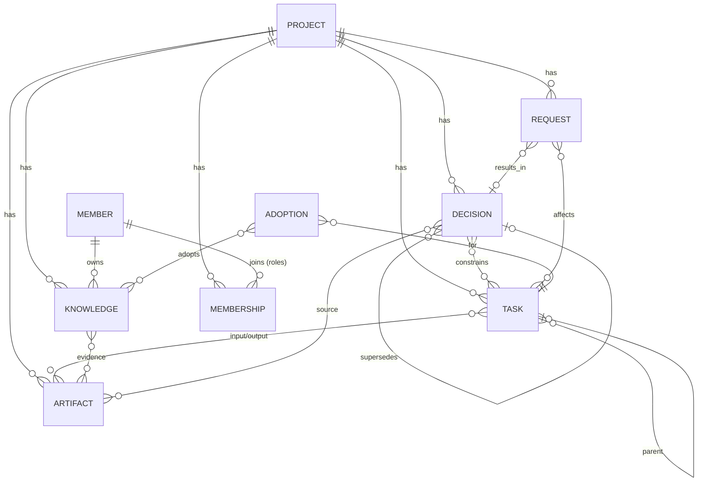
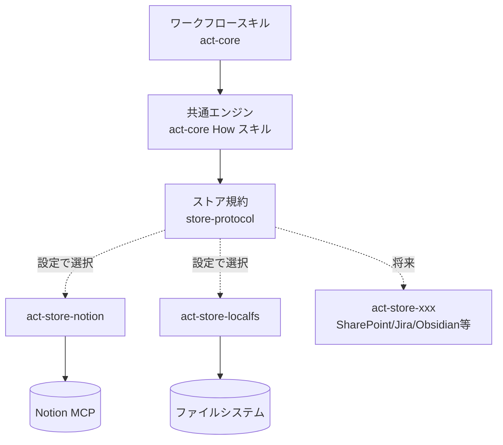

# ACTプラグイン 要件定義書（ドラフト v0.2）

- 作成日: 2026-10-22
- 対象: ACTモデル（Agentic, Context-driven Teamwork）を Claude 上で運用するためのプラグイン群
- 前提資料: [ACTモデル詳細解説](act-model/act-model-detailed.md)、[act-model.html](act-model/act-model.html)、[ポンチ絵](act-model/AI主体で描くACTモデル.png)
- 状態: ドラフト。**§9 の論点**はユーザー確認待ち。

---

## 1. 目的とスコープ

### 1.1 目的

ACTモデルの「C（Context-driven）」を実務で回すために、人間とその代理AIが日々の作業から **決定事項・タスク・ナレッジ・プロジェクトアーティファクト** などのコンテキストを抽出・保存・参照できるようにする。あわせて「A（Agentic）」の前提である **権限の境界**（誰が何を決めてよいか）を、ワークフローと保存先の権限設定の両方で守る。

### 1.2 対象ユーザーと層

| 対象 | 優先度 | 主な使い方 |
| --- | --- | --- |
| マネジメント層（マネージャー） | 高 | 議事録・資料から決定事項とタスクを確定し、進捗を評価して報告する |
| 実行層（ワーカー） | 高 | タスクのコンテキストを読み込んで作業し、進捗・成果物・知見・変更要求を返す |
| ビジネス層（ビジネスオーナー） | 低（将来） | 目的・制約の登録、判断依頼への回答。初期は汎用ワークフローで代用する |

役割は兼任できる（モデル §2.1, §5.5）。プラグインは「その操作をどの役割として行っているか」を毎回明示する。

### 1.2.1 複数プロジェクトへの参加

**一人のユーザーが複数のプロジェクトに同時に参加していることを前提とする。**

- 役割はプロジェクトごとに異なる（例: Aプロジェクトではマネージャー、Bプロジェクトではワーカー）。権限判定は常に「対象プロジェクトでの役割」で行う
- 保存先もプロジェクトごとに異なり得る（別の Notion ワークスペース、別の共有フォルダ、将来は別の保存先サービス）
- すべてのワークフローは最初に **対象プロジェクトを特定** してから動く（§3.4 プロジェクト解決）
- 横断して見たいもの（自分の担当タスク、自分宛ての判断依頼）は、プロジェクトをまたいで集約できる（C5）
- 1つの入力（例: 複数案件にまたがる会議の議事録）から、複数プロジェクトのコンテキストを抽出することがある。この場合は項目ごとに所属プロジェクトを判定し、プロジェクトごとの役割・保存先で書き込む

### 1.3 スコープ

- 含む: ワークフロー（スキル／サブエージェント）、コンテキストのデータモデル、保存先アダプタの仕組み、ローカル設定ファイル、Notion用アダプタ、ローカルファイルストレージ用アダプタ
- 含まない（初期）: 独自のWeb UI、Notion以外の保存先アダプタの実装（インターフェースだけ定義する）、通知基盤（Slack等）

### 1.4 実行環境

Claude Code と Claude Cowork の両方で動くプラグイン形式（`plugin.json` + `skills/` + `agents/`）で作る。Notion へのアクセスはユーザー本人の Notion MCP 接続を使う。これにより **「AIは操作する人間と同じ権限で動く」（モデル §6.2）が Notion 側の権限でそのまま実現される**。

---

## 2. 設計原則

モデルの記述から、プラグインが必ず守るルールを導く。

| # | 原則 | 根拠（モデル） | プラグインでの実現 |
| --- | --- | --- | --- |
| P1 | AIは操作者と同じ権限。権限は増えない | §6.2 | 保存先の認証は本人の接続を使う。プラグイン側でも役割チェックを行う |
| P2 | 確定した決定だけが下位の境界になる | §5.2 | 決定事項に `状態`（提案／確定／置換済み／取消）を持たせ、境界として使うのは `確定` のみ |
| P3 | ナレッジは所有者本人（と代理AI）だけが更新する | §8.2 | 他者のナレッジは閲覧のみ。他者向けの知見は「本人への提案（コメント）」として渡す |
| P4 | 矛盾するナレッジは統合しない。使う場面で採用する | §8.4–8.7 | 統合・上書き処理を持たない。採用した場合は採用記録を残す |
| P5 | ナレッジ採用・資料更新と、正式な決定は別 | §9 | 抽出結果から決定事項を作る際、権限がなければ `提案` として登録し判断依頼を作る |
| P6 | タスク追加は「既存の決定・タスクに影響するか」で判定 | §5.3–5.4 | 補助タスク追加時に影響チェックを行い、影響ありなら変更要求に切り替える |
| P7 | 記録・理解・決定を区別する | §6.3 | 1つの入力から「アーティファクト／ナレッジ／決定」を別々の型で抽出する |
| P8 | 置き場所と提出・受入れの行為を分ける | §3.3 | アーティファクトは所在と版をメタ情報で指し、提出・承認は状態遷移で表す |
| P9 | 根拠をたどれる | §11 | 抽出したすべての項目に出典（アーティファクトと版、スレッド）を紐づける |
| P10 | 書き込み前に人が確認できる | 運用上の要件 | 書き込み計画（追加・更新・提案の一覧）を提示し、承認後に保存する |
| P11 | 役割と権限はプロジェクト単位 | §2.1, §14.1 | 役割・保存先・ポリシーをプロジェクトごとに持ち、別プロジェクトの役割で書き込まない。プロジェクトをまたぐ情報の持ち出しは参照リンクに留める |

---

## 3. ワークフロー一覧

### 3.1 全体像



入力ごとのワークフローは違っても、後半の「抽出 → 権限ゲート → 重複チェック → 確認 → 保存」は共通エンジン（How スキル）として1か所にまとめる。

### 3.2 一覧

ID の接頭辞: `C`＝共通（全役割）、`M`＝マネジメント層、`E`＝実行層、`B`＝ビジネス層（将来）。

| ID | ワークフロー | 主な利用者 | トリガー | MVP |
| --- | --- | --- | --- | --- |
| C0 | 初期設定（プロジェクト参加） | 全員 | 初回利用時、新規プロジェクト時 | ✓ |
| C1 | 議事録の清書とコンテキスト更新 | 全員（決定の確定はM） | 文字起こしを渡したとき | ✓ |
| C2 | ファイル取り込み | 全員 | ファイルを渡したとき | ✓ |
| C3 | 自分のナレッジの登録・更新 | 全員 | 知見を残したいとき | ✓ |
| C4 | コンテキスト照会 | 全員 | 「Xについて何が決まっている？」等 | ✓ |
| C5 | マイデスク（プロジェクト横断の自分の状況） | 全員 | 「今日やること」「自分宛ての依頼は？」 | ✓ |
| C6 | プロジェクトの切り替え・一覧 | 全員 | 「Bプロジェクトの作業をする」 | ✓ |
| E1 | タスク着手ブリーフィング | 実行層 | タスクに取りかかるとき | ✓ |
| E2 | スレッドからのコンテキスト同期 | 実行層 | AIとの作業が進んだとき | ✓ |
| E3 | 完了報告・成果物提出 | 実行層 | タスクが終わったとき | ✓ |
| E4 | 変更要求（判断依頼）の起票 | 実行層 | 権限外の変更が必要になったとき | （E2に内包） |
| E5 | ナレッジ採用記録 | 実行層 | 矛盾するナレッジから選んだとき | （E1/E2に内包） |
| M1 | 決定事項の確定・改訂 | マネジメント層 | 提案の承認、方針変更時 | ✓ |
| M2 | タスク定義（分解・作成） | マネジメント層 | 要望・決定からタスクを作るとき | |
| M3 | 判断依頼のトリアージ | マネジメント層 | 判断依頼が溜まったとき | ✓ |
| M4 | 進捗評価・状況レポート | マネジメント層 | 定例前、週次 | |
| M5 | ビジネス層への判断依頼 | マネジメント層 | 上位の目的・制約を変える必要があるとき | |
| B1 | 目的・制約の登録 | ビジネス層 | プロジェクト開始時・方針変更時 | （将来） |
| B2 | 判断依頼への回答 | ビジネス層 | M5を受けたとき | （将来） |

### 3.3 各ワークフローの詳細

各ワークフローを「トリガー／入力／処理／抽出・更新するコンテキスト／権限上の判断境界／出力」で整理する。

#### C0 初期設定（プロジェクト参加）

- トリガー: 初回利用、新しいプロジェクトの開始・参加
- 入力: プロジェクト名、ローカルの共有フォルダ（Drive同期先）、自分の役割、保存先（Notion のデータベース等）
- 処理:
  1. 個人設定 `~/.act/config.yaml` を作成・更新（§6）
  2. 共有フォルダに `.act/project.yaml` が無ければ作成（プロジェクト作成者のみ）
  3. 保存先アダプタのセットアップ（Notion ならデータベース群の作成または既存の紐づけ）
  4. 接続確認（読み取り・書き込みの疎通、自分の権限の確認）
- 判断境界: データベースの新規作成はプロジェクトの作成者（通常マネージャー）が行う。他メンバーは既存の紐づけのみ
- 複数プロジェクト: 何度でも実行でき、実行するたびに個人設定の `projects` に1件追加する。既存プロジェクトの設定は変更しない。プロジェクトキー（ID の接頭辞に使う短い英字）の重複をチェックする

#### C1 議事録の清書とコンテキスト更新（ユーザー例1）

- トリガー: AIが文字起こしした議事録（テキスト、ファイル、Notion AIミーティングノート等）を渡したとき
- 入力: 文字起こし、会議名・日時・参加者（不明なら推定して確認）
- 処理:
  1. 清書（話者整理、議題ごとの要約、発言の要点、決定・宿題の明示）
  2. 清書版を議事録アーティファクトとして共有フォルダに保存し、メタ情報を登録（原文の文字起こしも入力アーティファクトとして保存するか設定で選ぶ）
  3. 共通エンジンで抽出: 決定事項、タスク（宿題）、ナレッジ（自分の理解）、判断依頼、関連アーティファクト
  4. 書き込み計画を提示 → 確認 → 保存
- 抽出・更新:
  - 決定事項: 会議で合意された内容。**操作者が決定権を持つ層の決定のみ `確定`、それ以外は `提案`**
  - タスク: 宿題・アクションアイテム。担当・期限・完了条件の欠けは「未定」として残す
  - ナレッジ: **操作者本人のナレッジとしてのみ作成**。他参加者の発言から得た理解も「本人の理解」として記録し、出典に議事録を紐づける
  - 判断依頼: 会議で「持ち帰り」「要確認」となった事項
- 判断境界:
  - ワーカーが議事録を処理した場合、決定事項は全件 `提案` になり、マネージャー宛ての判断依頼として集約される
  - 既存の確定済み決定と矛盾する内容は、自動で置き換えず「改訂提案」にする
- 出力: 議事録ファイル、Notion上の議事録メタ情報ページ（抽出したコンテキストへのリンク付き）

#### C2 ファイル取り込み（ユーザー例3）

- トリガー: ファイル（PDF、Office、画像、Markdown、コード等）を渡したとき
- 入力: ファイル、用途（入力資料／作業途中／検証・記録／最終成果、推定して確認）、関連タスク
- 処理:
  1. 種類・内容を判別し、命名規則に沿って共有フォルダに配置（同名・同内容があれば新しい版として扱う）
  2. メタ情報（名称・種類・用途・状態・版・要約・ハッシュ）を登録
  3. 内容から抽出: ナレッジ（本人の理解として）、決定事項の記述（決定記録の場合）、関連する既存タスク・決定へのリンク
  4. 書き込み計画を提示 → 確認 → 保存
- 判断境界: 「承認済み」状態への変更はアーティファクトの承認権限を持つ役割のみ（初期設定ではマネージャー）。資料の中に決定が書かれていても、それだけで決定事項を `確定` にしない（P5, モデル §9.3）
- 出力: 配置したファイルのパス、メタ情報ページ

#### C3 自分のナレッジの登録・更新

- トリガー: 「これ覚えておいて」「この理解を更新して」
- 処理: 既存の自分のナレッジを検索し、新規か更新かを判断。確認状態（確認済み／仮説／推測）と根拠を必ず付ける
- 判断境界: 更新できるのは自分のナレッジだけ。他者のナレッジに対しては、根拠付きのコメント（気づきの共有）を残すことだけができる（モデル §8.7）

#### C4 コンテキスト照会

- トリガー: 「Xについて何が決まっている？」「このタスクの前提は？」
- 処理: 決定事項（確定のみ／提案も含む を区別）、タスク、ナレッジ（所有者ごと）、アーティファクトを横断検索し、出典付きで回答
- 判断境界: 読み取りのみ。矛盾するナレッジは並べて示し、統合しない
- 複数プロジェクト: 既定は現在のプロジェクトのみ。「全プロジェクトで」と指示された場合は横断検索し、回答にプロジェクト名を必ず付ける

#### C5 マイデスク（プロジェクト横断の自分の状況）

- トリガー: 「今日やること」「自分宛ての判断依頼は？」「今週の状況」
- 処理: 個人設定に登録された全プロジェクトから、自分が担当のタスク（期限・状態順）、自分の役割宛ての未対応の判断依頼（マネージャーのプロジェクトのみ）、自分が出した判断依頼の回答状況、最近確定した決定のうち自分の担当タスクに関わるもの を集めて一覧にする
- 判断境界: 読み取りのみ。各プロジェクトの保存先に、そのプロジェクトの接続で問い合わせる。接続できないプロジェクトは「未取得」として示す

#### C6 プロジェクトの切り替え・一覧

- トリガー: 「Bプロジェクトの作業をする」「参加しているプロジェクトは？」
- 処理: 参加プロジェクトと各プロジェクトでの自分の役割を一覧表示し、現在のプロジェクトを切り替える（現在のプロジェクトはセッション内で保持し、個人設定の `default_project` は変えない）

#### E1 タスク着手ブリーフィング

- トリガー: 「タスク○○を始める」
- 処理: タスクの目的・範囲・入力（版付き）・期待出力・完了条件・制約、関連する確定済み決定、上位の目的・制約、関連ナレッジ（所有者・根拠・新しさ付き）、関連アーティファクトを集め、作業用のブリーフィングとしてスレッドに展開する。タスクの状態を「進行中」にする
- 判断境界: 矛盾するナレッジがある場合は候補として提示し、採用はユーザー（または代理AI）がその場で判断。採用したらE5の採用記録を残す
- 意義: モデル §14.4「AIが仕事を始める際には、代理する人間、担当する役割、有効な決定事項、対象タスク、関係するナレッジ・アーティファクトを識別できる状態にする」の実装

#### E2 スレッドからのコンテキスト同期（ユーザー例2）

- トリガー: エージェントAIとの作業が一区切りついたとき（手動起動。将来はセッション終了時のフック等で提案）
- 入力: 現在のスレッドの内容、対象タスク（E1で設定済みならそれを使う）
- 処理: スレッドから以下を抽出し、書き込み計画として提示
  - タスクの進捗（状態、進捗メモ、残作業の見積もり）
  - 補助タスクの追加 → **影響チェック**（§3.4）を通過したものだけ自律追加
  - 作成・更新したファイル → アーティファクトとして登録（新しい版）
  - 新しい知見 → 本人のナレッジ
  - 技術的な採用判断 → 採用記録
  - 権限外の変更が必要な事項 → 判断依頼（E4）
- 判断境界: 定義済みタスクの対象・期待成果・完了条件・期限の変更は書き込まず、判断依頼にする

#### E3 完了報告・成果物提出

- トリガー: 「このタスク完了」
- 処理: 完了条件を一つずつ照合し、成果物（アーティファクトと版）を指定して提出。タスクを「レビュー待ち」にし、マネージャー宛ての報告を作る。残課題・改善提案も添える
- 判断境界: 「完了」への最終遷移はタスク定義者（マネージャー）。ワーカーは「レビュー待ち」まで

#### M1 決定事項の確定・改訂

- トリガー: 提案中の決定を確定する、既存の決定を改訂する
- 処理: 決定の内容・層・決定者・有効日・置き換える既存の決定を確定。**影響を受けるタスクと担当者を洗い出し**、タスクへの反映案と通知文を作る（モデル §13.3）
- 判断境界: マネジメント層の決定はマネージャー、ビジネス層の決定はビジネスオーナーのみ確定できる。ビジネス層の制約に触れる場合はM5に回す

#### M2 タスク定義（分解・作成）

- トリガー: 要望・決定・議事録からタスクを作るとき
- 処理: モデル §11.1 の項目（目的・範囲・入力・期待出力・完了条件・制約・関連決定・関連ナレッジ・担当）を満たすタスクを作成。欠けている項目を指摘する
- 判断境界: 定義済みタスクの作成・変更はマネージャーのみ

#### M3 判断依頼のトリアージ

- トリガー: 判断依頼（ワーカーからの変更要求、議事録由来の提案決定）が溜まったとき
- 処理: 依頼ごとに影響（対象タスク、期限・費用、他担当者）を整理し、承認／却下／ビジネス層へ上げる の選択肢を提示。承認されたらM1・M2の更新を連鎖実行し、依頼者に結果を返す
- 判断境界: マネジメント層の権限内で処理できるか判定し、超えるものはM5へ

#### M4 進捗評価・状況レポート

- トリガー: 定例前、週次など
- 処理: タスクの状態・進捗メモ・完了報告・判断依頼から、**実績と予測を分けた**状況レポートを作り、アーティファクトとして保存（モデル §14.5）
- 出力: ビジネス層向け報告（現状・予測・成果物・選択肢・判断依頼）

#### M5 ビジネス層への判断依頼

- トリガー: 目的・期限・予算などビジネス層の制約を変える必要があるとき
- 処理: 選択肢と影響を整理した判断依頼を作成。回答が来たらビジネス層の決定として記録（ビジネスオーナー本人または代理AIが確定）

### 3.4 共通エンジン（How スキル）

ワークフローから呼ばれる共通部品。どの保存先でも同じ動きをする（コアプラグインに置く）。

| 部品 | 役割 |
| --- | --- |
| プロジェクト解決 | 対象プロジェクトを次の順で決める: ①ユーザーの明示 → ②入力ファイルのパスがどのプロジェクトの共有ルート配下か → ③セッションで選択中のプロジェクト → ④入力内容と各プロジェクト概要の照合（推定） → ⑤`default_project`。④⑤で決めた場合は書き込み計画で必ず明示して確認を取る。1つの入力に複数プロジェクトの内容が含まれる場合は項目ごとに割り当てる |
| コンテキスト抽出 | 入力テキストから型付きの候補（決定・タスク・ナレッジ・アーティファクト・判断依頼・採用記録）を、出典の位置付きで抽出する |
| 権限ゲート | **対象プロジェクトでの**操作者の役割と、対象の型・操作から「確定で書く／提案として書く／判断依頼にする／書かない」を決める（§5.3 の表） |
| タスク影響チェック | 補助タスク追加時にモデル §5.4 の5観点（目的・範囲、成果・完了条件、期限・費用・品質、他タスク・他担当、上位決定）で判定。判定不能なら判断依頼に倒す |
| 重複・差分チェック | 既存のコンテキストと照合し、新規／更新／重複（スキップ）を判定。出典ハッシュで同じ入力の二重取り込みを防ぐ |
| 書き込み計画 | 追加・更新・提案・スキップの一覧を、プロジェクトごと（プロジェクト名・その役割）に分けて表で示し、ユーザー確認後に保存。部分的な除外・修正を受け付ける |
| 出典付与 | 全項目に `出典アーティファクト（版）`、`出典スレッド`、`記録者`、`代理AI経由` を付ける |

---

## 4. データモデル

保存先に依存しない **正準モデル（canonical model）** をコアで定義し、アダプタが各保存先の表現に写像する。

### 4.1 エンティティと関係



### 4.2 共通項目

すべてのエンティティが持つ。

| 項目 | 型 | 説明 |
| --- | --- | --- |
| `id` | 文字列 | プラグインが採番する安定ID。プロジェクトキーを先頭に付け、プロジェクトをまたいで一意にする（例: `FAQ-DEC-0012`）。保存先のIDとは別に持つ |
| `project` | 参照 | 所属プロジェクト（必須。1件のエンティティは1つのプロジェクトにだけ属する） |
| `title` | 文字列 | 一行の名前 |
| `recorded_by` | メンバー | 記録した人間（代理AIが書いても本人） |
| `via_agent` | 真偽 | 代理AI経由で記録したか |
| `sources` | 参照の配列 | 出典（アーティファクトID＋版、スレッドURL等） |
| `created_at` / `updated_at` | 日時 | |

### 4.3 決定事項（Decision）

| 項目 | 型 | 説明 |
| --- | --- | --- |
| `content` | 本文 | 決定の内容 |
| `layer` | 選択 | `business` / `management` |
| `status` | 選択 | `proposed`（提案）/ `confirmed`（確定）/ `superseded`（置換済み）/ `revoked`（取消） |
| `decided_by` | メンバー | 決定した人（確定時に必須） |
| `decided_at` / `effective_from` | 日付 | 決定日・有効日 |
| `rationale` | 本文 | 理由 |
| `scope` | 文字列 | 適用範囲 |
| `supersedes` | 参照 | 置き換える決定 |
| `related_tasks` | 参照の配列 | 制約を受けるタスク |

下位の境界として使うのは `status = confirmed` のみ（P2）。

### 4.4 タスク（Task）

モデル §11.1 に準拠。

| 項目 | 型 | 説明 |
| --- | --- | --- |
| `kind` | 選択 | `defined`（マネージャー定義）/ `auxiliary`（ワーカーの補助タスク） |
| `parent` | 参照 | 親タスク（補助タスクは必須） |
| `purpose` | 本文 | 目的 |
| `scope` | 本文 | 対象範囲 |
| `inputs` | 参照の配列 | 入力アーティファクト（版付き） |
| `expected_output` | 本文 | 期待する出力 |
| `done_criteria` | 本文 | 完了条件 |
| `constraints` | 本文 | 期限・費用・品質・方式など |
| `due` | 日付 | 期限 |
| `priority` | 選択 | 高・中・低 |
| `status` | 選択 | `todo` / `in_progress` / `blocked` / `in_review` / `done` / `cancelled` |
| `assignee` | メンバー | 担当 |
| `defined_by` | メンバー | 定義者 |
| `related_decisions` / `related_knowledge` | 参照の配列 | |
| `progress_notes` | 本文（追記） | 進捗メモ、残作業の見積もり |
| `outputs` | 参照の配列 | 成果物アーティファクト（版付き） |

### 4.5 ナレッジ（Knowledge）

モデル §11.2 に準拠。

| 項目 | 型 | 説明 |
| --- | --- | --- |
| `owner` | メンバー | 所有者（更新できるのは本人のみ） |
| `content` | 本文 | 内容 |
| `kind` | 選択 | 事実 / 前提 / 背景・顧客理解 / 判断理由 / 方法 / 教訓 / 技術知見 |
| `applies_to` | 文字列 | 適用範囲（案件・顧客・データ・条件） |
| `evidence` | 本文 | 根拠（実測、検証、記録、直接確認） |
| `evidence_artifacts` | 参照の配列 | 根拠となるアーティファクト（版付き） |
| `confidence` | 選択 | 確認済み / 仮説 / 推測 |
| `caveats` | 本文 | 注意点・適用しない条件 |
| `valid_as_of` | 日付 | いつ時点の情報か |

### 4.6 プロジェクトアーティファクト（Artifact、メタ情報）

本体はファイルストレージ、メタ情報だけを保存先に置く。モデル §11.3 に準拠。

| 項目 | 型 | 説明 |
| --- | --- | --- |
| `kind` | 選択 | 議事録 / 要望書 / 仕様書 / 設計書 / 調査メモ / データ / コード / テスト結果 / 報告書 / その他 |
| `usage` | 複数選択 | 入力 / 作業途中 / 検証・記録 / 最終成果（用途は固定しない、モデル §7.5） |
| `status` | 選択 | 下書き / レビュー中 / 承認済み / 廃止 |
| `location` | 文字列 | 共有ルートからの相対パス（例: `minutes/2026-10-22_定例.md`） |
| `storage` | 文字列 | 本体の保存先アダプタ名（例: `localfs`） |
| `share_url` | URL | 任意。Drive等の共有リンク |
| `version` | 文字列 | 版（例: `v3`） |
| `content_hash` | 文字列 | 本体のハッシュ（変更検知・二重取り込み防止） |
| `summary` | 本文 | 要約 |
| `author` / `last_editor` | メンバー | |
| `related_tasks` / `related_decisions` / `related_knowledge` | 参照の配列 | |

### 4.7 判断依頼（Request）

モデルの「判断依頼」「変更要求」を一つの型で扱う。決定事項の `proposed` と組み合わせて使う。

| 項目 | 型 | 説明 |
| --- | --- | --- |
| `kind` | 選択 | タスク変更 / 決定の確定・改訂 / ビジネス制約の変更 / その他確認 |
| `to_role` | 選択 | `manager` / `business_owner` |
| `content` | 本文 | 依頼内容と背景 |
| `impact` | 本文 | 影響（対象タスク、期限・費用、他担当者） |
| `options` | 本文 | 選択肢 |
| `status` | 選択 | 未対応 / 検討中 / 承認 / 却下 / 上位へ |
| `requested_by` | メンバー | |
| `answered_by` | メンバー | |
| `affected_tasks` | 参照の配列 | |
| `proposed_decision` / `result_decision` | 参照 | |

### 4.8 ナレッジ採用記録（Adoption）

モデル §11.4。記録の要否はプロジェクト設定で切り替える（既定: 矛盾があったときだけ記録）。

| 項目 | 型 | 説明 |
| --- | --- | --- |
| `task` | 参照 | 使ったタスク・判断 |
| `adopted` | 参照の配列 | 採用したナレッジ |
| `not_adopted` | 参照の配列 | 採用しなかったナレッジ |
| `reason` | 本文 | 重視した根拠・条件（専門性／根拠／適合性／最新性／接点） |
| `applied_scope` | 本文 | 適用範囲 |
| `needs_formal_change` | 真偽 | 正式な決定・タスク変更が必要だったか |

### 4.9 プロジェクト（Project）とメンバーシップ

複数プロジェクト参加を前提に、プロジェクトとその中での役割を明示的に持つ。

| エンティティ | 項目 | 説明 |
| --- | --- | --- |
| Project | `key` | 短い英字のプロジェクトキー（ID の接頭辞、例: `FAQ`） |
| | `name` / `purpose` / `constraints` | 名前、目的、主要な制約（ビジネス層のアウトプットの要約） |
| | `status` | 準備中 / 進行中 / 完了 / 中止 |
| Membership | `project` / `member` | どのプロジェクトの誰か |
| | `roles` | そのプロジェクトでの役割（複数可）。権限判定はこれを使う |
| | `scope` | 担当領域（同じ役割を複数人が担う場合の分担、モデル §13.1） |

- 正（権限の強制）は保存先側の権限設定。Membership は「誰がどの役割か」をメンバー全員が確認できるようにする共有の記録で、個人設定の `roles` と食い違う場合は警告する
- ナレッジはプロジェクトに属する（モデルの定義が「プロジェクトにおける知識」のため）。複数プロジェクトに通じる個人の知見の扱いは §9 論点8

### 4.10 将来追加するもの

- 目的・制約（Goal / Constraint）: ビジネス層のアウトプット。初期は `layer = business` の決定事項と Project の `purpose` / `constraints` で代用する

---

## 5. アーキテクチャ（コアとアダプタの分離）

### 5.1 プラグイン構成

```
act-teamwork/                    # マーケットプレイス（このリポジトリ）
├── plugins/
│   ├── act-core/                # コア: ワークフロー、共通エンジン、正準モデル、権限ポリシー
│   │   ├── skills/
│   │   │   ├── setup/           # C0
│   │   │   ├── ingest-minutes/  # C1
│   │   │   ├── ingest-file/     # C2
│   │   │   ├── knowledge/       # C3
│   │   │   ├── ask/             # C4
│   │   │   ├── my-desk/         # C5
│   │   │   ├── project/         # C6
│   │   │   ├── start-task/      # E1
│   │   │   ├── sync-thread/     # E2
│   │   │   ├── complete-task/   # E3
│   │   │   ├── decide/          # M1
│   │   │   ├── triage/          # M3
│   │   │   ├── project-resolution/   # How: 対象プロジェクトの特定
│   │   │   ├── context-extraction/   # How: 抽出
│   │   │   ├── permission-gate/      # How: 権限ゲート・影響チェック
│   │   │   ├── write-plan/           # How: 重複チェック・書き込み計画
│   │   │   └── store-protocol/       # How: アダプタ呼び出し規約
│   │   ├── schema/              # 正準モデル（JSON Schema）
│   │   └── policy/              # 既定の権限ポリシー
│   ├── act-store-notion/        # アダプタ: Notion（メタ情報・決定・タスク・ナレッジ・判断依頼）
│   │   └── skills/{store, setup}
│   └── act-store-localfs/       # アダプタ: ローカルファイル（アーティファクト本体）
│       └── skills/{store}
└── docs/
```

### 5.2 依存の向き



- コアは保存先を知らない。保存先はコンテキストの型ごとに設定ファイルで選ぶ（§6）
- アダプタはコアのワークフローを知らない。正準モデルと「ストア操作」だけを知る

### 5.3 ストア規約（コアとアダプタのインターフェース）

コアは次の操作を、正準モデルの JSON で依頼する。アダプタは各保存先で実行して正準モデルの JSON で返す。

| 操作 | 入力 | 出力 |
| --- | --- | --- |
| `describe` | なし | 対応する型、対応操作、権限の確認方法 |
| `setup` | プロジェクト設定 | 作成・紐づけした保存先の識別子 |
| `query` | 型、条件（状態・担当・期間・キーワード・関連ID） | エンティティの配列 |
| `get` | 型、ID | エンティティ |
| `create` | 型、エンティティ | ID、保存先URL |
| `update` | 型、ID、変更項目 | 更新後のエンティティ |
| `link` | 2つのID、関係名 | なし |
| `comment` | 型、ID、本文 | なし（他者のナレッジへの気づき共有に使う） |
| `check_permission` | 型、ID または型のみ、操作 | 可否（分かる範囲で） |
| `put_file` / `get_file`（本体用） | パス、内容／版 | 位置、ハッシュ |

アダプタは「スキル」として実装し、コアのスキルが設定に従って `act-store-notion:store` のように呼び出す。権限エラー（保存先が拒否した）を正準のエラー `permission_denied` に変換して返し、コアはそれを「提案に切り替える」等で処理する。

将来、規約が安定したらアダプタを MCP サーバーとして実装し、スキルよりも厳密なインターフェースに移行できる（§9 論点5）。

### 5.4 権限の二重化

| 層 | 役割 | 位置づけ |
| --- | --- | --- |
| 保存先（Notion）の権限 | 本当の強制。本人の接続で書くので、権限のない操作は失敗する | 正 |
| プラグインの権限ゲート | 失敗する前に「提案にする／判断依頼にする」と振り分け、利用者体験を整える。Notionで表現できない細かいルール（項目単位の制限など）も補う | 補助 |

ローカル設定ファイルの役割は自己申告なので、**最終的な強制は必ず保存先側に置く**。

### 5.5 権限ゲートの既定ポリシー

| 対象・操作 | ビジネスオーナー | マネージャー | ワーカー |
| --- | --- | --- | --- |
| 決定事項（business）を確定 | ✓ | 提案のみ | 提案のみ |
| 決定事項（management）を確定 | ✓ | ✓ | 提案のみ |
| 決定事項を提案 | ✓ | ✓ | ✓ |
| 定義済みタスクの作成・対象／完了条件／期限の変更 | ✓ | ✓ | 判断依頼 |
| 補助タスクの追加 | ✓ | ✓ | 影響チェック通過時のみ ✓ |
| タスクの状態・進捗メモ（自分の担当） | ✓ | ✓ | ✓（`done` はレビュー待ちまで） |
| 自分のナレッジの作成・更新 | ✓ | ✓ | ✓ |
| 他者のナレッジの更新 | ✗（コメントのみ） | ✗（コメントのみ） | ✗（コメントのみ） |
| アーティファクトの登録・新しい版 | ✓ | ✓ | ✓ |
| アーティファクトを「承認済み」にする | ✓ | ✓ | ✗ |
| 判断依頼の起票 | ✓ | ✓ | ✓ |
| 判断依頼への回答 | ✓ | ✓（management範囲） | ✗ |

ポリシーはプロジェクト設定（`.act/project.yaml` の `policy`）で上書きできる（モデル §13）。

---

## 6. ローカル設定ファイル仕様

役割は「人 × プロジェクト」ごと、保存先はプロジェクト共通なので、**2つのファイルに分ける**。共有フォルダに役割を置くと他メンバーと共有されてしまうため。

### 6.1 個人設定 `~/.act/config.yaml`

1人が複数のプロジェクトに参加する前提で、**参加プロジェクトごとに役割と共有フォルダの場所を持つ**。

```yaml
version: 1
me:
  name: 伊志嶺朝輝
  email: user@example.com          # 保存先のユーザーとの照合に使う
default_project: FAQ               # プロジェクトを特定できないときの最後の候補（§3.4）
projects:                          # 参加しているプロジェクト（キー = プロジェクトキー）
  FAQ:
    name: 社内FAQ AI検証
    roles: [manager, worker]       # このプロジェクトでの役割。兼任可。business_owner / manager / worker
    root: ~/Google Drive/共有ドライブ/faq-poc   # 共有フォルダのローカルパス（PCごとに違う）
    accounts:                      # このプロジェクトの保存先で使う自分のアカウント
      notion: { workspace: <ワークスペースID>, user: <Notion ユーザーID> }
  CRM:
    name: CRM刷新
    roles: [worker]                # 別プロジェクトでは別の役割
    root: ~/Google Drive/共有ドライブ/crm-renewal
    accounts:
      notion: { workspace: <別のワークスペースID>, user: <...> }
    status: active                 # active / archived（archived は C5 の集約対象外）
preferences:
  confirm_before_write: always     # always / on_conflict
  language: ja
```

- プロジェクトの詳細（保存先など）は各 `root/.act/project.yaml` から読む。個人設定には自分に固有の情報（役割、ローカルパス、アカウント）だけを置く
- プロジェクトキーは全参加プロジェクトで一意。共有設定の `project.key` と一致しなければ警告する
- 保存先の接続（Notion MCP 等）が1つのワークスペースにしかつながらない環境では、別ワークスペースのプロジェクトに書く前に「いまの接続先がこのプロジェクトのワークスペースか」を `accounts` と照合し、違えば書き込みを止める

### 6.2 プロジェクト設定 `<root>/.act/project.yaml`（共有フォルダ内、メンバー共通）

```yaml
version: 1
project:
  key: FAQ                         # プロジェクトキー（ID の接頭辞にも使う）
  name: 社内FAQ AI検証
stores:                            # コンテキストの型ごとに保存先を選ぶ
  artifact_body:
    adapter: localfs
    layout:                        # 共有ルート内の配置規則
      minutes: minutes/{date}_{title}.md
      input: inputs/{kind}/{title}{ext}
      working: work/{title}{ext}
      deliverable: deliverables/{title}_{version}{ext}
  artifact_meta:
    adapter: notion
    database: <Notion データソースID>
  decision:
    adapter: notion
    database: <...>
  task:
    adapter: notion
    database: <...>
  knowledge:
    adapter: notion
    database: <...>
  request:
    adapter: notion
    database: <...>
  adoption:
    adapter: notion
    database: <...>
policy:                            # §5.5 の既定を上書きする場合のみ
  artifact_approve: [manager, business_owner]
  adoption_record: on_conflict     # always / on_conflict / never
id_prefix:                         # 実際の ID は {project.key}-{prefix}-{連番}（例: FAQ-DEC-0012）
  decision: DEC
  task: TSK
  knowledge: KNW
  artifact: ART
  request: REQ
```

- 秘密情報（トークン等）は書かない。保存先への認証は各ツールの接続（Notion MCP 等）に任せる
- 個人設定の `root` が無いプロジェクトは使えない（C0で設定する）

---

## 7. Notion での保存例（設計案）

### 7.1 ページ構成

複数プロジェクトを前提に、**プロジェクトごとにDB一式を持つ**。権限（誰がマネージャーか）はプロジェクトごとに違うため、DBをプロジェクト間で共有すると権限を分けられない。プロジェクトをまたいだ一覧（C5）はプラグインが各DBに問い合わせて集約する。

```
ACT（ルート）
└── ACT: 社内FAQ AI検証（例）           ← プロジェクトのトップページ（プロジェクトごとに1つ）
├── 📌 プロジェクト概要                 目的・制約（ビジネス層）、プロジェクトキー
├── 👥 メンバー DB                      メンバーとこのプロジェクトでの役割（Membership）
├── 🗂 決定事項 DB                      ← マネージャー・ビジネスオーナーのみ編集、他は閲覧＋コメント
├── ✅ タスク DB                        ← 全員編集（項目単位の制限はプラグイン側）
├── 📨 判断依頼 DB                      ← 全員作成、回答はマネージャー
├── 📄 アーティファクト DB（メタ情報）  ← 全員編集。本体はローカル／Drive
├── 🧠 ナレッジ DB                      ← 1つのDB＋行単位の権限で所有者のみ編集（§9 論点1 で決定）
└── 🔎 採用記録 DB
```

各DBの項目は §4 の正準モデルを日本語プロパティ名で写像する（例: `status` → 「状態」、`recorded_by` → 「記録者」、`via_agent` → 「代理AI経由」）。DB間はリレーションで結ぶ。

### 7.1.1 作成済みの例（2026-10-22）

Notion のプライベートページ「ACT（保存例）」配下に「ACT: 社内FAQ AI検証（例）」として作成済み: https://app.notion.com/p/401684ddb9a48171998ff3b2835c7398

作成して分かった写像上の決め事:

- 人を指す項目（記録者・担当・決定者など）は **メンバーDBへのリレーション** にする。Notion アカウントを持たない人（社外・架空）も扱え、プロジェクトでの役割をたどれるため
- 権限ルールに使う項目だけ **Person 型** を別に持つ（ナレッジの「所有者アカウント」）。行単位の権限ルールは Person 型でしか書けないため
- ID はNotionの一意ID（`FAQ-DEC-1` 等の接頭辞付き連番）で表示する。正準モデルの `id` はこれを使ってもよい
- 決定事項の置き換え、タスクの親子は自己リレーション（双方向）で表す

### 7.2 Notion の権限で表現できること・できないこと

| 要件 | Notion での実現 | 補足 |
| --- | --- | --- |
| 決定事項はマネージャーのみ編集 | 決定事項DBのページ権限で、マネージャーを「編集可」、他メンバーを「コメント可」 | 全プランで可能 |
| ナレッジは所有者のみ更新 | 1つのDBで、DB全体はメンバーに「閲覧可（コメント可）」、行単位の権限ルールで「所有者（Personプロパティ）に一致する人は編集可」とする | 行単位の権限ルールはプランに依存し、APIからは設定できない可能性が高い。設定手順はC0のセットアップで案内する。使えない場合はプラグインの権限ゲートだけの制御になる |
| タスクの項目単位の制限（完了条件はマネージャーのみ等） | 表現できない | プラグインの権限ゲートで補う |
| 代理AIは本人と同じ権限 | 本人の Notion MCP 接続で書くので自動的に成立 | |

### 7.3 例として作るデータ

モデル §10 の「社内FAQのAI検証」を題材に、各DBに2〜3件ずつ入れて関係を確認する。

- 決定事項: 「評価は通常文書を優先する」（business, 確定）、「画像PDFの文字抽出は次フェーズ」（management, 提案）
- タスク: 「検索方式の試作」（defined）、「検証結果の集計スクリプト作成」（auxiliary, 親=試作）
- ナレッジ: マネージャー「PDFはそのまま取り込める」（推測）、開発者「画像PDFは文字抽出が必要」（確認済み）← 矛盾の併存例
- 判断依頼: 「文字抽出の追加による見積もり変更」（タスク変更 → マネージャー）
- アーティファクト: 「2026-10-22 キックオフ議事録」（議事録・検証/記録・承認済み）、「FAQ評価データ v1」（データ・入力）
- 採用記録: 「試作で開発者のナレッジを採用」

---

## 8. 非機能要件

| 区分 | 要件 |
| --- | --- |
| 確認 | 保存先への書き込み前に必ず書き込み計画を示す（設定で「衝突時のみ」に緩和可） |
| 冪等性 | 同じ入力（ハッシュ）を二度取り込んでも重複を作らない |
| 追跡性 | 全項目に出典・記録者・代理AI経由を残す |
| 可搬性 | 正準モデルとストア規約を保存先から独立させる。アダプタを追加するだけで保存先を変えられる |
| 部分失敗 | 複数の保存先に書く途中で失敗したら、書けたもの・書けなかったものを一覧で返し、再実行で続きから書ける |
| 言語 | UI・保存内容は日本語を既定 |
| 秘密情報 | 設定ファイルやリポジトリに認証情報を置かない |

---

## 9. 確認が必要な論点

| # | 論点 | 推奨 | 理由 |
| --- | --- | --- | --- |
| 1 | ナレッジの「所有者のみ更新」を Notion でどう強制するか | **決定（2026-10-22）: 1つのDB＋行単位の権限ルール** | 管理と検索がしやすい。プラン依存の点はセットアップ時に確認する |
| 2 | 実行環境 | Claude Code と Cowork の両方で動く形式 | スキル形式は共通。ファイル操作は Cowork の接続フォルダ／Claude Code のローカルの両方を想定 |
| 3 | MVP の範囲 | §3.2 の ✓（C0〜C6, E1〜E3, M1, M3） | ユーザー例の3つ＋それを回すのに最低限必要な確定・判断依頼の流れ |
| 4 | 議事録の原文（文字起こし）も保存するか | 保存する（入力アーティファクトとして） | 清書の根拠をたどれる（P9） |
| 5 | アダプタの実装方式 | 初期はスキル（Notion MCP を使う）、将来 MCP サーバー化を検討 | 初期は実装が軽く、Notion MCP の権限をそのまま使える |
| 6 | アーティファクトの版管理 | 承認済み・提出物はファイル名に版を付け、作業途中は上書き＋メタ情報の版番号 | Drive の版履歴だけでは「どの版を提出したか」を指せないため |
| 7 | E2 の自動起動 | 初期は手動起動。将来 Claude Code のフックで「同期しますか？」と提案 | 自動書き込みは誤抽出のリスクが高い |
| 8 | 複数プロジェクトに通じる個人の知見（例: 汎用的な技術知見、教訓）の置き場所 | 初期はナレッジを必ずどれか1つのプロジェクトに属させ、別プロジェクトからは参照リンクで使う。将来、個人設定に「個人ナレッジ」の保存先を追加できるようにする | モデルのナレッジは「プロジェクトにおける知識」。プロジェクトごとに閲覧できるメンバーが違うため、勝手に別プロジェクトへ複製すると情報が漏れる |
| 9 | 1つの議事録に複数プロジェクトの内容がある場合の議事録本体の置き場所 | 主となるプロジェクトの共有フォルダに置き、他プロジェクトにはメタ情報（該当部分の要約と所在）だけを登録する | 本体を複製すると版がずれる。ただし他プロジェクトのメンバーが本体を開けない場合があるため、要約を必ず付ける |

---

## 10. 次のステップ

1. 本書の論点（§9）を確定する
2. Notion に §7 のページ構成で例を作り、項目と権限設定を検証する
3. 正準モデルを JSON Schema 化し、ストア規約を確定する
4. MVP のワークフローから実装（C0 → C2 → C1 → E1 → E2 の順を想定）
