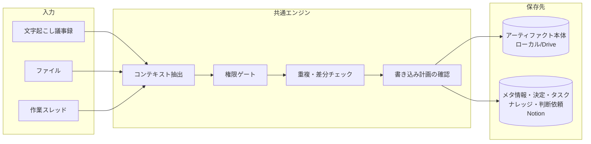
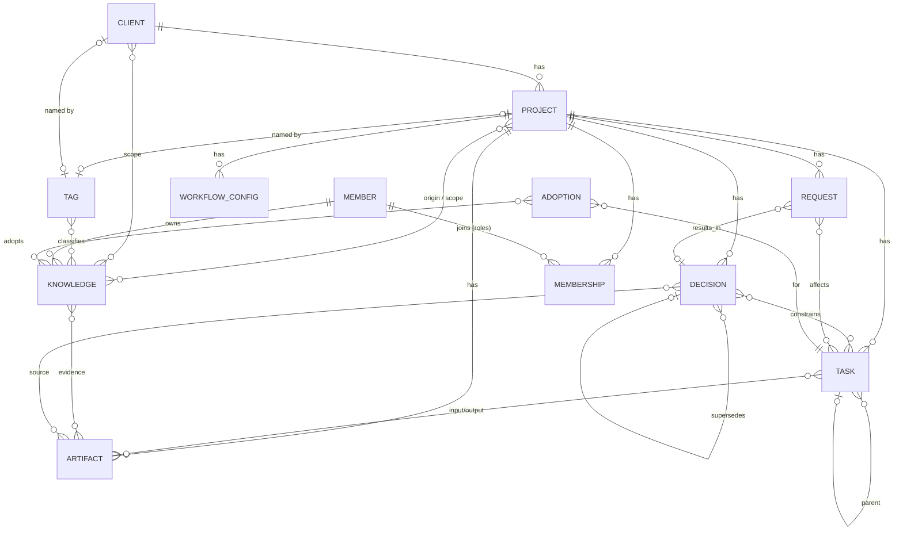
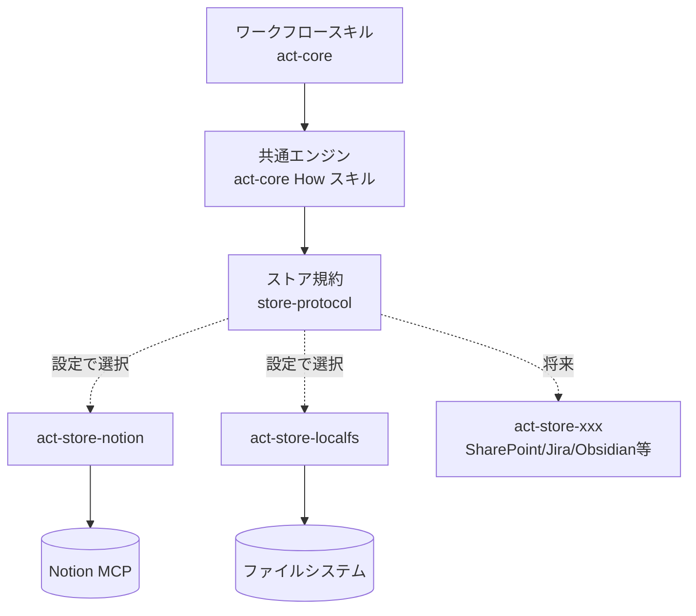

# ACTプラグイン 要件定義書（ドラフト v0.11）

- 作成日: 2026-10-22
- 対象: ACTモデル（Agentic, Context-driven Teamwork）を Claude 上で運用するためのプラグイン群
- 前提資料: [ACTモデル詳細解説](act-model/act-model-detailed.md)、[act-model.html](act-model/act-model.html)、[ポンチ絵](act-model/AI主体で描くACTモデル.png)
- 状態: ドラフト。**§9 の論点**はユーザー確認待ち。

---

## 1. 目的とスコープ

### 1.1 目的

ACTモデルの「C（Context-driven）」を実務で回すために、人間とその代理AIが日々の作業から **決定事項・タスク・ナレッジ・プロジェクトアーティファクト** などのコンテキストを抽出・保存・参照できるようにする。あわせて「A（Agentic）」の前提である **権限の境界**（誰が何を決めてよいか）を、ワークフローと保存先の権限設定の両方で守る。

### 1.2 対象ユーザーと層

| 対象 | 優先度 | 主な使い方 |
| --- | --- | --- |
| マネジメント層（マネージャー） | 高 | 議事録・資料から決定事項とタスクを確定し、進捗を評価して報告する |
| 実行層（ワーカー） | 高 | タスクのコンテキストを読み込んで作業し、進捗・成果物・知見・変更要求を返す |
| ビジネス層（ビジネスオーナー） | 低（将来） | 目的・制約の登録、判断依頼への回答。初期は汎用ワークフローで代用する |

役割は兼任できる（モデル §2.1, §5.5）。プラグインは「その操作をどの役割として行っているか」を毎回明示する。

### 1.2.1 複数プロジェクトへの参加

**一人のユーザーが複数のプロジェクトに同時に参加していることを前提とする。**

- 役割はプロジェクトごとに異なる（例: Aプロジェクトではマネージャー、Bプロジェクトではワーカー）。権限判定は常に「対象プロジェクトでの役割」で行う
- 保存先もプロジェクトごとに異なり得る（別の Notion ワークスペース、別の共有フォルダ、将来は別の保存先サービス）
- すべてのワークフローは最初に **対象プロジェクトを特定** してから動く（§3.4 プロジェクト解決）
- 横断して見たいもの（自分の担当タスク、自分宛ての判断依頼）は、プロジェクトをまたいで集約できる（C5）
- ナレッジだけは **全プロジェクト共通の1つの保存先** に置く。実際のプロジェクト名・クライアント名をタグにして、プロジェクトの外からでも「このお客さんの決算っていつだっけ？」のように引けるようにする（§4.5）
- 1つの入力（例: 複数案件にまたがる会議の議事録）から、複数プロジェクトのコンテキストを抽出することがある。この場合は項目ごとに所属プロジェクトを判定し、プロジェクトごとの役割・保存先で書き込む

### 1.3 スコープ

- 含む: ワークフロー（スキル／サブエージェント）、コンテキストのデータモデル、保存先アダプタの仕組み、ローカル設定ファイル、Notion用アダプタ、ローカルファイルストレージ用アダプタ
- 含まない（初期）: 独自のWeb UI、Notion以外の保存先アダプタの実装（インターフェースだけ定義する）、通知基盤（Slack等）

### 1.4 実行環境

Claude Code と Claude Cowork の両方で動くプラグイン形式（`plugin.json` + `skills/` + `agents/`）で作る。Notion へのアクセスはユーザー本人の Notion MCP 接続を使う。これにより **「AIは操作する人間と同じ権限で動く」（モデル §6.2）が Notion 側の権限でそのまま実現される**。

---

## 2. 設計原則

モデルの記述から、プラグインが必ず守るルールを導く。

| # | 原則 | 根拠（モデル） | プラグインでの実現 |
| --- | --- | --- | --- |
| P1 | AIは操作者と同じ権限。権限は増えない | §6.2 | 保存先の認証は本人の接続を使う。プラグイン側でも役割チェックを行う |
| P2 | 確定した決定だけが下位の境界になる | §5.2 | 決定事項に `状態`（提案／確定／置換済み／取消）を持たせ、境界として使うのは `確定` のみ |
| P3 | ナレッジは所有者本人（と代理AI）だけが更新する | §8.2 | 他者のナレッジは閲覧のみ。他者向けの知見は「本人への提案（コメント）」として渡す |
| P4 | 矛盾するナレッジは統合しない。使う場面で採用する | §8.4–8.7 | 統合・上書き処理を持たない。採用した場合は採用記録を残す |
| P5 | ナレッジ採用・資料更新と、正式な決定は別 | §9 | 抽出結果から決定事項を作る際、権限がなければ `提案` として登録し判断依頼を作る |
| P6 | タスク追加は「既存の決定・タスクに影響するか」で判定 | §5.3–5.4 | 補助タスク追加時に影響チェックを行い、影響ありなら変更要求に切り替える |
| P7 | 記録・理解・決定を区別する | §6.3 | 1つの入力から「アーティファクト／ナレッジ／決定」を別々の型で抽出する |
| P8 | 置き場所と提出・受入れの行為を分ける | §3.3 | アーティファクトは所在と版をメタ情報で指し、提出・承認は状態遷移で表す |
| P9 | 根拠をたどれる | §11 | 抽出したすべての項目に出典（アーティファクトと版、スレッド）を紐づける |
| P10 | 書き込み前に人が確認できる | 運用上の要件 | 書き込み計画（追加・更新・提案の一覧）を提示し、承認後に保存する |
| P11 | 役割と権限はプロジェクト単位 | §2.1, §14.1 | 役割・保存先・ポリシーをプロジェクトごとに持ち、別プロジェクトの役割で書き込まない。プロジェクトをまたぐ情報の持ち出しは参照リンクに留める。例外はナレッジで、全プロジェクト共通のDBに置き、プロジェクト名・クライアント名のタグで引く（§4.5） |
| P12 | 確信のない更新はしない。確認してから書く | 運用上の要件 | 書き込み計画の各項目に確信度（高／中／低）と理由を付ける。中・低の項目は既定で「保留」にし、ユーザーが選んだものだけを書く。確認を緩める設定や定期実行でも、確信度が高い項目以外は自動で書かない（§3.4.1） |
| P13 | 確認は答えやすい形で取る | 運用上の要件 | ユーザーに確認するときは、チャットに文章で答えさせず、AI の推奨を入れたフォーム（チェック・選択肢・短い修正欄）で答えられるようにする（§3.4.2） |

---

## 3. ワークフロー一覧

### 3.1 全体像



入力ごとのワークフローは違っても、後半の「抽出 → 権限ゲート → 重複チェック → 確認 → 保存」は共通エンジン（How スキル）として1か所にまとめる。

### 3.2 一覧

ID の接頭辞: `C`＝共通（全役割）、`M`＝マネジメント層、`E`＝実行層、`B`＝ビジネス層（将来）。

| ID | ワークフロー | 主な利用者 | トリガー | MVP |
| --- | --- | --- | --- | --- |
| C0 | 初期設定（プロジェクト参加） | 全員 | 初回利用時、新規プロジェクト時 | ✓ |
| C1 | 議事録の清書とコンテキスト更新 | 全員（決定の確定はM） | 文字起こしを渡したとき | ✓ |
| C2 | ファイル取り込み | 全員 | ファイルを渡したとき | ✓ |
| C3 | 自分のナレッジの登録・更新 | 全員 | 知見を残したいとき | ✓ |
| C4 | コンテキスト照会 | 全員 | 「Xについて何が決まっている？」等 | ✓ |
| C5 | マイデスク（プロジェクト横断の自分の状況） | 全員 | 「今日やること」「自分宛ての依頼は？」 | ✓ |
| C6 | プロジェクトの切り替え・一覧 | 全員 | 「Bプロジェクトの作業をする」 | ✓ |
| E1 | タスク着手ブリーフィング | 実行層 | タスクに取りかかるとき | ✓ |
| E2 | スレッドからのコンテキスト同期 | 実行層 | AIとの作業が進んだとき | ✓ |
| E3 | 完了報告・成果物提出 | 実行層 | タスクが終わったとき | ✓ |
| E4 | 変更要求（判断依頼）の起票 | 実行層 | 権限外の変更が必要になったとき | （E2に内包） |
| E5 | ナレッジ採用記録 | 実行層 | 矛盾するナレッジから選んだとき | （E1/E2に内包） |
| M1 | 決定事項の確定・改訂 | マネジメント層 | 提案の承認、方針変更時 | ✓ |
| M2 | タスク定義（分解・作成） | マネジメント層 | 要望・決定からタスクを作るとき | |
| M3 | 判断依頼のトリアージ | マネジメント層 | 判断依頼が溜まったとき | ✓ |
| M4 | 進捗評価・状況レポート | マネジメント層 | 定例前、週次 | |
| M5 | ビジネス層への判断依頼 | マネジメント層 | 上位の目的・制約を変える必要があるとき | |
| M6 | デイリープロジェクトサマリー | マネジメント層（閲覧は全員） | **毎日の定期実行**（手動実行も可） | ✓ |
| M7 | タスク・決定事項の棚卸し | マネジメント層 | 週次の定期実行で候補を作り、マネージャーが手動で整理を実行 | |
| B1 | 目的・制約の登録 | ビジネス層 | プロジェクト開始時・方針変更時 | （将来） |
| B2 | 判断依頼への回答 | ビジネス層 | M5を受けたとき | （将来） |

### 3.3 各ワークフローの詳細

各ワークフローを「トリガー／入力／処理／抽出・更新するコンテキスト／権限上の判断境界／出力」で整理する。

#### C0 初期設定（プロジェクト参加・保存先の作成／取り込み／更新）

- トリガー: 初回利用、新しいプロジェクトの開始・参加、既存のNotionページをACT用にしたいとき、プラグインのバージョンアップ後
- 入力: プロジェクト名、ローカルの共有フォルダ（Drive同期先）、自分の役割、保存先（Notion なら親ページまたは既存ページのURL）
- 保存先のセットアップには3つのモードがあり、保存先の状態から自動で判定して確認を取る:

  | モード | 状態 | 動き |
  | --- | --- | --- |
  | 新規作成 | 指定ページの下に ACT のDBが無い | §7.1 の構成でDB一式を作る |
  | 取り込み | 既存のページ・DBがあるが ACT の管理下にない（スキーマ版の記録が無い） | 既存DBと正準モデルの対応づけ案（DB名・プロパティ名・型の類似から推定）を示し、確認後に不足分を追加して ACT の管理下に置く |
  | 更新 | ACT の管理下にあり、記録されたスキーマ版がプラグインの版より古い | 移行計画（§5.6）を示し、確認後に差分を適用する |

- 処理:
  1. 個人設定 `~/.act/config.yaml` を作成・更新（§6）
  2. 共有フォルダに `.act/project.yaml` が無ければ作成（プロジェクト作成者のみ）。共通のプロジェクト一覧に登録し、クライアントを選ぶ（無ければ作る）。あわせてタグ一覧に `プロジェクト:<名前>`（新しいクライアントなら `クライアント:<名前>` も）を作る
  3. 保存先アダプタのセットアップ（上の3モード）。アダプタの `inspect` で現状を読み、`plan` で変更計画を作り、ユーザーが確認してから `apply` する
  4. 接続確認（読み取り・書き込みの疎通、自分の権限の確認）
  5. 適用したスキーマ版を保存先と `project.yaml` に記録する
  6. ワークフロー設定（§4.10）が空なら、プラグイン同梱の既定（用語・表記辞書のひな形、議事録の清書ルール等）を `下書き` で登録する。利用者が選べば、代わりに参加中の別プロジェクトの設定をコピーする。既にあるページは上書きしない
- 判断境界: データベースの作成・取り込み・更新はプロジェクトの作成者（通常マネージャー）だけが行う。他メンバーは既存の紐づけのみ。他メンバーが古いスキーマ版のプロジェクトを使った場合は、警告を出して管理者に更新を促す（書き込みは、旧版でも安全に書ける項目に限って続ける）
- 複数プロジェクト: 何度でも実行でき、実行するたびに個人設定の `projects` に1件追加する。既存プロジェクトの設定は変更しない。プロジェクトキー（ID の接頭辞に使う短い英字）の重複をチェックする

#### C1 議事録の清書とコンテキスト更新（ユーザー例1）

- トリガー: AIが文字起こしした議事録（テキスト、ファイル、Notion AIミーティングノート等）を渡したとき
- 入力: 文字起こし、会議名・日時・参加者（不明なら推定して確認）
- 処理:
  0. ワークフロー設定（§4.10）から、対象に「C1 議事録」を含む `有効` な設定を読み込む（用語・表記辞書、議事録の清書ルール等）
  1. 清書（話者整理、議題ごとの要約、発言の要点、決定・宿題の明示）。辞書で誤変換・表記ゆれを正記に直し、文脈で意味が変わる語は置き換えずに印を付けて確認に回す
  2. 清書版を議事録アーティファクトとして共有フォルダに保存し、メタ情報を登録（原文の文字起こしも入力アーティファクトとして保存するか設定で選ぶ）
  3. 共通エンジンで抽出: 決定事項、タスク（宿題）、ナレッジ（自分の理解）、判断依頼、関連アーティファクト
  4. 書き込み計画を提示 → 確認 → 保存。清書中に見つけた辞書に無い誤変換らしい語は「辞書への追加候補」として計画に載せ、採用されたものだけを辞書に追記する
- 抽出・更新:
  - 決定事項: 会議で合意された内容。**操作者が決定権を持つ層の決定のみ `確定`、それ以外は `提案`**
  - タスク: 宿題・アクションアイテム。担当・期限・完了条件の欠けは「未定」として残す
  - ナレッジ: **操作者本人のナレッジとしてのみ作成**。他参加者の発言から得た理解も「本人の理解」として記録し、出典に議事録を紐づける
  - 判断依頼: 会議で「持ち帰り」「要確認」となった事項
- 判断境界:
  - ワーカーが議事録を処理した場合、決定事項は全件 `提案` になり、マネージャー宛ての判断依頼として集約される
  - 既存の確定済み決定と矛盾する内容は、自動で置き換えず「改訂提案」にする
- 出力: 議事録ファイル、Notion上の議事録メタ情報ページ（抽出したコンテキストへのリンク付き）

#### C2 ファイル取り込み（ユーザー例3）

- トリガー: ファイル（PDF、Office、画像、Markdown、コード等）を渡したとき
- 入力: ファイル、用途（入力資料／作業途中／検証・記録／最終成果、推定して確認）、関連タスク
- 処理:
  0. ワークフロー設定から、対象に「C2 ファイル取り込み」を含む `有効` な設定（用語・表記辞書等）を読み込む
  1. 種類・内容を判別し、命名規則に沿って共有フォルダに配置（同名・同内容があれば新しい版として扱う）
  2. メタ情報（名称・種類・用途・状態・版・要約・ハッシュ）を登録
  3. 内容から抽出: ナレッジ（本人の理解として）、決定事項の記述（決定記録の場合）、関連する既存タスク・決定へのリンク
  4. 書き込み計画を提示 → 確認 → 保存
- 判断境界: 「承認済み」状態への変更はアーティファクトの承認権限を持つ役割のみ（初期設定ではマネージャー）。資料の中に決定が書かれていても、それだけで決定事項を `確定` にしない（P5, モデル §9.3）
- 出力: 配置したファイルのパス、メタ情報ページ

#### C3 自分のナレッジの登録・更新

- トリガー: 「これ覚えておいて」「この理解を更新して」
- 処理: 既存の自分のナレッジを検索し、新規か更新かを判断。確認状態（確認済み／仮説／推測）と根拠を必ず付ける
- タグ付け: 内容に関わる `プロジェクト:<名前>` と `クライアント:<名前>` を付ける（両方付けてよい）。どれにも属さない知見は `汎用`。加えて `種類:` を1つ以上、`話題:` を必要に応じて付ける。共通のタグ一覧（§4.5.1）にあるタグから選び、推定したタグは書き込み計画で確認を取る。合うタグが無いときは、作成ルール（R1〜R7）に沿った新しい `話題:` タグ（名前・定義・似たタグとの違い）を書き込み計画に含め、確認後に作る
- `汎用` に変える（プロジェクト・クライアントのタグを外す）のは所有者だけ。書き込み計画で、案件名・顧客名・個人情報などを本文から除いた版を提案する
- 判断境界: 更新できるのは自分のナレッジだけ。他者のナレッジに対しては、根拠付きのコメント（気づきの共有）を残すことだけができる（モデル §8.7）

#### C4 コンテキスト照会

- トリガー: 「Xについて何が決まっている？」「このタスクの前提は？」
- 処理: 決定事項（確定のみ／提案も含む を区別）、タスク、ナレッジ（所有者ごと）、アーティファクトを横断検索し、出典付きで回答
- 判断境界: 読み取りのみ。矛盾するナレッジは並べて示し、統合しない
- 複数プロジェクト: 既定は現在のプロジェクトのみ。「全プロジェクトで」と指示された場合は横断検索し、回答にプロジェクト名を必ず付ける
- ナレッジの検索: プロジェクトの中では既定で `プロジェクト:<このプロジェクト>`＋`クライアント:<このプロジェクトのクライアント>`＋`汎用` を対象にする。プロジェクトの外（どのプロジェクトも選んでいない状態）や「○○社の…」という問いでは、文中のクライアント名・プロジェクト名・話題を、タグ一覧の正式名と別名に照合してタグで絞る（非推奨のタグは統合先に読み替える）。回答には元のプロジェクト名を添える

#### C5 マイデスク（プロジェクト横断の自分の状況）

- トリガー: 「今日やること」「自分宛ての判断依頼は？」「今週の状況」
- 処理: 個人設定に登録された全プロジェクトから、自分が担当のタスク（期限・状態順）、自分の役割宛ての未対応の判断依頼（マネージャーのプロジェクトのみ）、自分が出した判断依頼の回答状況、最近確定した決定のうち自分の担当タスクに関わるもの を集めて一覧にする
- 判断境界: 読み取りのみ。各プロジェクトの保存先に、そのプロジェクトの接続で問い合わせる。接続できないプロジェクトは「未取得」として示す

#### C6 プロジェクトの切り替え・一覧

- トリガー: 「Bプロジェクトの作業をする」「参加しているプロジェクトは？」
- 処理: 参加プロジェクトと各プロジェクトでの自分の役割を一覧表示し、現在のプロジェクトを切り替える（現在のプロジェクトはセッション内で保持し、個人設定の `default_project` は変えない）

#### E1 タスク着手ブリーフィング

- トリガー: 「タスク○○を始める」
- 処理: タスクの目的・範囲・入力（版付き）・期待出力・完了条件・制約、関連する確定済み決定、上位の目的・制約、関連ナレッジ（所有者・根拠・新しさ付き）、関連アーティファクトを集め、作業用のブリーフィングとしてスレッドに展開する。タスクの状態を「進行中」にする
- 判断境界: 矛盾するナレッジがある場合は候補として提示し、採用はユーザー（または代理AI）がその場で判断。採用したらE5の採用記録を残す
- 意義: モデル §14.4「AIが仕事を始める際には、代理する人間、担当する役割、有効な決定事項、対象タスク、関係するナレッジ・アーティファクトを識別できる状態にする」の実装

#### E2 スレッドからのコンテキスト同期（ユーザー例2）

- トリガー: エージェントAIとの作業が一区切りついたとき（手動起動。将来はセッション終了時のフック等で提案）
- 入力: 現在のスレッドの内容、対象タスク（E1で設定済みならそれを使う）
- 処理: スレッドから以下を抽出し、書き込み計画として提示
  - タスクの進捗（状態、進捗メモ、残作業の見積もり）
  - 補助タスクの追加 → **影響チェック**（§3.4）を通過したものだけ自律追加
  - 作成・更新したファイル → アーティファクトとして登録（新しい版）
  - 新しい知見 → 本人のナレッジ
  - 技術的な採用判断 → 採用記録
  - 権限外の変更が必要な事項 → 判断依頼（E4）
- 判断境界: 定義済みタスクの対象・期待成果・完了条件・期限の変更は書き込まず、判断依頼にする

#### E3 完了報告・成果物提出

- トリガー: 「このタスク完了」
- 処理: 完了条件を一つずつ照合し、成果物（アーティファクトと版）を指定して提出。タスクを「レビュー待ち」にし、マネージャー宛ての報告を作る。残課題・改善提案も添える
- 判断境界: 「完了」への最終遷移はタスク定義者（マネージャー）。ワーカーは「レビュー待ち」まで

#### M1 決定事項の確定・改訂

- トリガー: 提案中の決定を確定する、既存の決定を改訂する
- 処理: 決定の内容・層・決定者・有効日・置き換える既存の決定を確定。**影響を受けるタスクと担当者を洗い出し**、タスクへの反映案と通知文を作る（モデル §13.3）
- 判断境界: マネジメント層の決定はマネージャー、ビジネス層の決定はビジネスオーナーのみ確定できる。ビジネス層の制約に触れる場合はM5に回す

#### M2 タスク定義（分解・作成）

- トリガー: 要望・決定・議事録からタスクを作るとき
- 処理: モデル §11.1 の項目（目的・範囲・入力・期待出力・完了条件・制約・関連決定・関連ナレッジ・担当）を満たすタスクを作成。欠けている項目を指摘する
- 判断境界: 定義済みタスクの作成・変更はマネージャーのみ

#### M3 判断依頼のトリアージ

- トリガー: 判断依頼（ワーカーからの変更要求、議事録由来の提案決定）が溜まったとき
- 処理: 依頼ごとに影響（対象タスク、期限・費用、他担当者）を整理し、承認／却下／ビジネス層へ上げる の選択肢を提示。承認されたらM1・M2の更新を連鎖実行し、依頼者に結果を返す
- 判断境界: マネジメント層の権限内で処理できるか判定し、超えるものはM5へ

#### M4 進捗評価・状況レポート

- トリガー: 定例前、週次など
- 処理: タスクの状態・進捗メモ・完了報告・判断依頼から、**実績と予測を分けた**状況レポートを作り、アーティファクトとして保存（モデル §14.5）
- 出力: ビジネス層向け報告（現状・予測・成果物・選択肢・判断依頼）

#### M5 ビジネス層への判断依頼

- トリガー: 目的・期限・予算などビジネス層の制約を変える必要があるとき
- 処理: 選択肢と影響を整理した判断依頼を作成。回答が来たらビジネス層の決定として記録（ビジネスオーナー本人または代理AIが確定）

#### M6 デイリープロジェクトサマリー

- トリガー: 毎日決まった時刻の定期実行（`project.yaml` の `schedules`）。手動でも実行できる
- 入力: 前回のサマリー以降に変わったコンテキスト（決定・タスク・判断依頼・アーティファクト・ナレッジ）。属性の `更新日時` で差分を取り、変化のあったページだけ本文を読む
- 処理: プロジェクトごとに次の構成のサマリーを作る
  1. 一言で: 今日のプロジェクトの状態（順調／注意／要判断）と理由
  2. 前日からの変化: 確定・提案された決定、状態が変わったタスク、新しい判断依頼と回答、承認されたアーティファクト
  3. 要注意: 期限切れ・期限間近のタスク、ブロック中のタスク、状況サマリが古いタスク（`状況更新日` が N 日以上前）、回答待ちが長い判断依頼
  4. 今日の判断事項: マネージャー・ビジネスオーナー宛ての未対応の判断依頼
  5. 実績と予測: 完了数・残数、遅れの見込み（モデル §14.5 に従い実績と予測を分ける）
- 出力: サマリーをアーティファクト（種類=報告書、用途=検証・記録）として保存し、Notion ではプロジェクトトップページの「最新サマリー」欄を置き換え、過去分は「デイリーサマリー」DBに1日1ページで残す。本文は人が読む形、日付・状態（順調／注意／要判断）・件数はプロパティにする（§7.2）
- 判断境界: **読み取りと、サマリー自体の書き込みだけを行う**。定期実行では人の確認が取れないため、タスクや決定事項は変更しない。気づいた問題は「要注意」に載せるだけで、整理は M7 や各ワークフローで人が承認して行う
- 実行者: 定期実行は設定した人（通常マネージャー）の権限で動く。サマリーには、その人が読めた範囲だけが載る
- 複数プロジェクト: 個人設定の全プロジェクトのうち `schedules` が有効なものを順に実行する。C5（マイデスク）は個人向け、M6 はプロジェクト向けで、M6 の結果は C5 からも参照できる

#### M7 タスク・決定事項の棚卸し

- トリガー: マネージャーが「棚卸しして」と実行する。週次の定期実行では整理案の作成までを行い、適用は手動
- 処理: 次の観点で整理が必要な項目を洗い出し、項目ごとに推奨アクションを付けた**整理計画**を作る

  | 対象 | 観点 | 推奨アクションの例 |
  | --- | --- | --- |
  | タスク | 期限切れ、長期間更新がない、レビュー待ちのまま止まっている | 状態の見直し、担当への確認、期限の再設定（判断依頼にする） |
  | タスク | 親タスクが完了・中止した補助タスク、重複・統合できるタスク | 完了・中止にする、統合する |
  | タスク | 完了条件が未記入、目的が無い（§11.1 の項目欠け） | 定義の補完を依頼 |
  | 決定事項 | 置き換えられたのに「確定」のまま、互いに矛盾する確定済みの決定 | 「置換済み」にする、改訂の判断依頼を作る |
  | 決定事項 | 長期間「提案」のまま | 確定・却下を判断する |
  | 判断依頼 | 回答済みなのに結果が反映されていない、長期間未対応 | 決定・タスクへ反映、催促 |
  | アーティファクト | 長期間「下書き」、本体ファイルが所在に無い・ハッシュ不一致 | 状態の見直し、所在の修正 |
  | ナレッジ | 古い、仮説のまま、確定した決定と食い違う | **所有者への確認依頼（コメント）だけ**。他者のナレッジは変更しない（P3） |
| タグ | 前回以降に作られたタグ（作成ルール違反）、使用件数が0〜1件、似たタグ・表記ゆれ、非推奨のタグがまだ付いている、プロジェクト・クライアント一覧と名前がずれている | 統合（非推奨＋統合先）、改名、別名への追加。付け替えは所有者への確認依頼 |

- 出力: 整理計画を表で提示し、マネージャーが項目ごとに採否を選ぶ。採用された分だけ適用し、適用結果を棚卸しレポート（アーティファクト）として残す
- 判断境界: タスク定義の変更・決定事項の状態変更はマネージャー（ビジネス層の決定はビジネスオーナー）だけが適用できる。ワーカーが実行した場合は、自分の担当タスクの状態整理だけを適用し、残りは判断依頼にする。削除は行わず「中止」「置換済み」「廃止」の状態で残す（履歴を追えるように）

### 3.4 共通エンジン（How スキル）

ワークフローから呼ばれる共通部品。どの保存先でも同じ動きをする（コアプラグインに置く）。

| 部品 | 役割 |
| --- | --- |
| プロジェクト解決 | 対象プロジェクトを次の順で決める: ①ユーザーの明示 → ②入力ファイルのパスがどのプロジェクトの共有ルート配下か → ③セッションで選択中のプロジェクト → ④入力内容と各プロジェクト概要の照合（推定） → ⑤`default_project`。④⑤で決めた場合は書き込み計画で必ず明示して確認を取る。1つの入力に複数プロジェクトの内容が含まれる場合は項目ごとに割り当てる |
| コンテキスト抽出 | 入力テキストから型付きの候補（決定・タスク・ナレッジ・アーティファクト・判断依頼・採用記録）を、出典の位置付きで抽出する |
| 権限ゲート | **対象プロジェクトでの**操作者の役割と、対象の型・操作から「確定で書く／提案として書く／判断依頼にする／書かない」を決める（§5.3 の表） |
| タスク影響チェック | 補助タスク追加時にモデル §5.4 の5観点（目的・範囲、成果・完了条件、期限・費用・品質、他タスク・他担当、上位決定）で判定。判定不能なら判断依頼に倒す |
| 重複・差分チェック | 既存のコンテキストと照合し、新規／更新／重複（スキップ）を判定。出典ハッシュで同じ入力の二重取り込みを防ぐ |
| 書き込み計画 | 追加・更新・提案・スキップの一覧を、プロジェクトごと（プロジェクト名・その役割）に分けて示し、ユーザー確認後に保存。各項目に確信度と理由を付ける（§3.4.1）。確認は確認フォーム（§3.4.2）で取り、部分的な除外・修正を受け付ける |
| 確信度の判定 | 抽出・推定した各項目と、その中の推定した値（プロジェクト、担当、期限、タグ、決定かどうか等）の確信度を判定する（§3.4.1） |
| 確認フォーム | ユーザーへの確認を、実行環境で使える入力部品（選択式の質問、フォーム、確認ページ）に組み立てて表示し、答えを書き込み計画に反映する（§3.4.2） |
| 出典付与 | 全項目に `出典アーティファクト（版）`、`出典スレッド`、`記録者`、`代理AI経由` を付ける |
| ワークフロー設定の読み込み | 実行の初めに、対象ワークフローに合う `有効` なワークフロー設定（§4.10）を集め、プラグイン既定の上に重ねて渡す。どの設定のどの版を使ったかを出力の出典に残す |

#### 3.4.1 確信度と確認

コンテキストの更新（追加・変更・状態の変更）は、AI が内容に確信を持てるものだけを、確認の後に書く。確信がないものは推測で埋めずにユーザーに聞く。

| 確信度 | 基準 | 例 | 既定の扱い |
| --- | --- | --- | --- |
| 高 | 入力にはっきり書かれていて、解釈が1つに決まる | 「A案で決定」「担当は佐藤さん、期限は11/5」 | 書き込み計画で「採用」を選んだ状態で示す |
| 中 | 文脈から推定した。妥当だが別の読み方もありうる | 発言の流れから決定と読める、日付が「来週中」 | 「保留」で示し、推定の根拠と AI の推奨を添える |
| 低 | 曖昧・矛盾がある、または必要な値が入力に無い | 誰の担当か不明、二つの発言が食い違う、決定か意見か分からない | 「保留」で示し、確認の質問にする。値は空のまま |

- 項目全体だけでなく、項目の中の推定した値（対象プロジェクト、担当、期限、タグ、決定事項の層、ナレッジの確認状態など）にも確信度を付け、中・低の値だけを質問にする
- 「保留」のまま確認を終えた項目は書かない。次回の実行で同じ入力を読んだときに再び示せるよう、保留した項目を実行ログに残す
- 次の更新は確信度にかかわらず確認を取る: 既存の項目の上書き・状態の変更（完了、置換済み、中止など）、他者が記録した項目の変更、ナレッジの `汎用` 化、新しいタグの作成
- 確認を緩める設定（`confirm_before_write: on_conflict`）でも、自動で書くのは確信度が高く、既存の項目と衝突しない追加だけ
- 定期実行（M6・M7）や将来のフックでの自動起動中は、人に確認できないため書き込まない。確認が必要な項目は「確認待ち」として次にユーザーが開いたときに示す

#### 3.4.2 確認フォーム

ユーザーに確認するときは、チャットに文章で答えさせるのではなく、**答えをクリックで選べる形** にする。

- **推奨を入れておく**: 各項目に AI の推奨（採用／保留／除外、推定した値）を初期値として入れる。ユーザーは違うところだけ直せばよい
- **選択式を基本にする**: 採否はチェック、候補がある値（プロジェクト、担当、タグ、層、状態）は選択肢、日付は日付入力。自由記述は「修正があれば」の短い欄だけにする
- **まとめて答えられるようにする**: 確信度が高い項目は「すべて採用」でまとめて確定できるようにし、確認が必要な項目（中・低）を先頭に並べる。1回の確認で答える質問の数は少なくする（目安: 一度に表示する質問は5問まで、残りは次の画面）
- **理由を添える**: 中・低の項目には「なぜ確認するか」（推定の根拠、食い違う出典）を1行で添える
- **実行環境に合わせて部品を選ぶ**（使えないときは下の段に下がる）:

  | 段 | 部品 | 使う場面 |
  | --- | --- | --- |
  | 1 | 実行環境の選択式の質問（Claude Code・Cowork の質問ツール。選択肢・複数選択） | 質問が少ない（目安4問以下）とき |
  | 2 | フォーム・確認ページ（Cowork の入力ウィジェット、回答を受け取れる Artifact ページ） | 書き込み計画の項目が多い、表で見比べたいとき |
  | 3 | チャットの番号付き一覧 | 上の部品が無いとき。「2, 5 を除外」「3 の担当は佐藤」のように短く答えられる形にする |

- 答えを受け取ったら、反映後の書き込み計画を短く示してから保存する（反映結果の確認はまとめて1回）

---

## 4. データモデル

保存先に依存しない **正準モデル（canonical model）** をコアで定義し、アダプタが各保存先の表現に写像する。

### 4.0 属性と記述

正準モデルの項目は、使われ方で2つに分ける。保存先は区分に合った場所に置く（Notion なら属性＝プロパティ、記述＝ページ本文。§7.2）。

| 区分 | 主な読み手・使い方 | 例 | 置き方の原則 |
| --- | --- | --- | --- |
| **属性（attribute）** | AI が検索・絞り込み・集計・関連づけに使う | 状態、種類、日付、担当などの人、ID、関連、所在・版・ハッシュ | 値は短く、選択肢や型を固定する。人が読む文章は入れない |
| **記述（narrative）** | 人が開いて読み、確認・判断する | 状況サマリ、目的、インプットの説明、完了条件、決定の内容と理由、ナレッジの内容と根拠、判断依頼の背景と選択肢 | 種類ごとに **固定の見出し（セクション）** で構成する。AI も見出しを手がかりに読み書きする |

以下の各表の「区分」列が `記述` の項目は、保存先では本文のセクションとして扱う。セクション名は §7.2 のテンプレートに従う。

### 4.1 エンティティと関係



### 4.2 共通項目

すべてのエンティティが持つ。

| 項目 | 型 | 説明 |
| --- | --- | --- |
| `id` | 文字列 | プラグインが採番する安定ID。プロジェクトキーを先頭に付け、プロジェクトをまたいで一意にする（例: `FAQ-DEC-0012`）。保存先のIDとは別に持つ |
| `project` | 参照 | 所属プロジェクト（必須。1件のエンティティは1つのプロジェクトにだけ属する）。ナレッジだけは例外で、全プロジェクト共通に置き、プロジェクト名・クライアント名のタグで絞る（§4.5） |
| `title` | 文字列 | 一行の名前 |
| `recorded_by` | メンバー | 記録した人間（代理AIが書いても本人） |
| `via_agent` | 真偽 | 代理AI経由で記録したか |
| `sources` | 参照の配列 | 出典（アーティファクトID＋版、スレッドURL等） |
| `created_at` / `updated_at` | 日時 | |

### 4.3 決定事項（Decision）

| 項目 | 型 | 区分 | 説明 |
| --- | --- | --- | --- |
| `layer` | 選択 | 属性 | `business` / `management` |
| `status` | 選択 | 属性 | `proposed`（提案）/ `confirmed`（確定）/ `superseded`（置換済み）/ `revoked`（取消） |
| `decided_by` | メンバー | 属性 | 決定した人（確定時に必須） |
| `decided_at` / `effective_from` | 日付 | 属性 | 決定日・有効日 |
| `supersedes` | 参照 | 属性 | 置き換える決定 |
| `related_tasks` | 参照の配列 | 属性 | 制約を受けるタスク |
| `content` | 文章 | 記述 | 決定内容 |
| `rationale` | 文章 | 記述 | 理由 |
| `scope` | 文章 | 記述 | 適用範囲 |
| `history` | 文章 | 記述 | 経緯（どの会議・依頼で決まったか、何を置き換えたか） |

下位の境界として使うのは `status = confirmed` のみ（P2）。

### 4.4 タスク（Task）

モデル §11.1 に準拠。

| 項目 | 型 | 区分 | 説明 |
| --- | --- | --- | --- |
| `kind` | 選択 | 属性 | `defined`（マネージャー定義）/ `auxiliary`（ワーカーの補助タスク） |
| `parent` | 参照 | 属性 | 親タスク（補助タスクは必須） |
| `status` | 選択 | 属性 | `todo` / `in_progress` / `blocked` / `in_review` / `done` / `cancelled` |
| `due` | 日付 | 属性 | 期限 |
| `priority` | 選択 | 属性 | 高・中・低 |
| `assignee` / `defined_by` | メンバー | 属性 | 担当、定義者 |
| `inputs` / `outputs` | 参照の配列 | 属性 | 入力・成果物アーティファクト（版は本文のインプット欄にも書く） |
| `related_decisions` / `related_knowledge` / `requests` | 参照の配列 | 属性 | |
| `status_updated_at` | 日付 | 属性 | 状況サマリを最後に更新した日（古いサマリの検出に使う） |
| `status_summary` | 文章 | 記述 | **状況サマリ**。いまどこまで進み、何が懸念か。AI が同期のたびに書き換える |
| `purpose` | 文章 | 記述 | 目的 |
| `scope` | 文章 | 記述 | 対象範囲（対象外も書く） |
| `inputs_note` | 文章 | 記述 | インプットの説明（どの版を、何のために使うか） |
| `expected_output` | 文章 | 記述 | 期待する出力 |
| `done_criteria` | チェックリスト | 記述 | 完了条件。1条件1項目。E3 で1つずつ照合してチェックする |
| `constraints` | 文章 | 記述 | 期限・費用・品質・方式など |
| `progress_log` | 日付付きの追記 | 記述 | 進捗ログ。残作業の見積もり、追加した補助タスク、起票した判断依頼など |
| `impact_check` | 表 | 記述 | 補助タスクのみ。追加時の影響チェック（モデル §5.4 の5観点）の結果 |

### 4.5 ナレッジ（Knowledge）

モデル §11.2 に準拠。**全プロジェクト共通の1つの保存先に置き**、分類は固定の「種類」ではなく **タグ** で行う。

| 項目 | 型 | 区分 | 説明 |
| --- | --- | --- | --- |
| `id` | 文字列 | 属性 | プロジェクトに属さないため、プロジェクトキーを付けない（例: `KNW-12`） |
| `owner` | アカウント | 属性 | 所有者（更新できるのは本人のみ）。プロジェクトをまたぐため、プロジェクトのメンバー表ではなく保存先のアカウントで持つ |
| `tags` | 参照の配列 | 属性 | 共通のタグ一覧（§4.5.1）への参照。`軸:値` の形の名前を持つ。軸は下表 |
| `visible_to` | アカウント・グループの配列 | 属性 | 閲覧を絞るときだけ設定（空なら全メンバーが閲覧可）。§9 論点14 |
| `confidence` | 選択 | 属性 | 確認済み / 仮説 / 推測 |
| `valid_as_of` | 日付 | 属性 | いつ時点の情報か |
| `applies_to` | 短い文字列 | 属性 | 適用範囲のキーワード（データ・条件など）。E1 で関連ナレッジを絞り込むのに使う |
| `evidence_artifacts` | 参照の配列 | 属性 | 根拠となるアーティファクト。保存先ではアーティファクト側から張る（§7.2） |
| `content` | 文章 | 記述 | 内容 |
| `evidence` | 文章 | 記述 | 根拠（実測、検証、記録、直接確認） |
| `caveats` | 文章 | 記述 | 注意点・適用しない条件 |

タグ（共通のタグ一覧から選ぶ。Notion ならタグDBへのリレーション）:

| タグ | 例 | 付け方 |
| --- | --- | --- |
| `プロジェクト:<案件名>` | `プロジェクト:社内FAQ AI検証` | そのプロジェクトに関わる知識。名前は共通のプロジェクト一覧の正式名。C0 でプロジェクトを登録したときにタグも作る |
| `クライアント:<会社名>` | `クライアント:みなと商事` | そのクライアントに関わる知識（決算期、繁忙期、重視すること、担当者の好み等）。プロジェクトが終わっても残り、次の案件やプロジェクト外から引ける |
| `汎用` | | 特定のプロジェクト・クライアントに依らない知見（技術知見、教訓、方法） |
| `種類:<種類>` | `種類:技術知見` | 1つ以上。値は固定（事実 / 前提 / 背景・顧客理解 / 判断理由 / 方法 / 教訓 / 技術知見） |
| `話題:<一般名詞>` | `話題:PDF`、`話題:スケジュール` | 任意で1〜2個。既存のタグから選ぶ。合うものが無ければ、作成ルール（§4.5.1）に沿って誰でも作れる |

**タグの粒度**（再利用しやすさを優先する）:

| 軸 | 粒度 | タグにしないもの（本文か `applies_to` に書く） |
| --- | --- | --- |
| クライアント | **会社（法人）単位**。グループ会社は原則別の会社として登録する。社内案件は自社名 | 部署、担当者、拠点 |
| プロジェクト | **案件（契約・目的のまとまり）単位**。共通のプロジェクト一覧と1対1 | フェーズ、工程、スプリント |
| 話題 | **別の案件でも使う一般的な言葉**（例: PDF、検索、スケジュール、見積もり、セキュリティ）。目安として、将来3件以上のナレッジに付きそうなもの | 案件固有の用語、製品の型番、1回しか出ない言葉 |

- AI は新しいタグを作る前に、タグ一覧の名前と `別名` で既存のタグとの類似（表記ゆれ、上位・下位の関係）を調べ、近いものがあればそれを使う。迷ったら広い方を選ぶ
- タグの数は1件あたり、プロジェクト・クライアントを除いて `種類:` 1〜2個＋`話題:` 1〜2個を目安にする。細かい条件は `applies_to` に書く
- M7 棚卸しで、タグ一覧の `使用件数` を見て、使用が0〜1件のタグ、似たタグ、プロジェクト・クライアント一覧とずれたタグを見つけて統合・改名を提案する

- プロジェクト・クライアントの名前の正は共通の一覧（§4.9）。名前が変わったらタグも合わせて変える（M7 棚卸しで一覧とタグのずれを検出し、変更を提案する）。表記ゆれ・似たタグの統合も M7 で提案する
- `プロジェクト:` `クライアント:` `汎用` のどれも無いナレッジは作らない
- 将来、軸を足すときはプラグインのスキーマ版を上げて C0 で反映する（例: `部署:`、`工程:`）

#### 4.5.1 タグ（Tag）

タグの粒度を保つため、タグは **全プロジェクト共通のタグ一覧** で管理する。ナレッジは一覧にあるタグだけを付けられ、自由入力はしない。

| 項目 | 型 | 区分 | 説明 |
| --- | --- | --- | --- |
| `id` | 文字列 | 属性 | 例: `TAG-3` |
| `name` | 文字列 | 属性 | `軸:値` の形の正式名（例: `話題:スケジュール`）。`汎用` だけは値を持たない |
| `axis` | 選択 | 属性 | プロジェクト / クライアント / 汎用 / 種類 / 話題 |
| `status` | 選択 | 属性 | 有効 / 非推奨。非推奨のタグは新しく付けない |
| `aliases` | 短い文字列 | 属性 | 別名・表記ゆれ（例: `日程, 時期, 繁忙期`）。AI が問いや本文の言葉を正式名に照合するのに使う |
| `merged_into` | 参照 | 属性 | 非推奨にしたときの統合先のタグ |
| `created_by` / `created_at` | アカウント / 日時 | 属性 | 作成者と作成日時。M7 で新しいタグを見直すのに使う |
| `project` / `client` | 参照 | 属性 | `プロジェクト:` `クライアント:` のタグが指す共通一覧の項目（§4.9） |
| `usage_count` | 数値（集計） | 属性 | 付いているナレッジの件数。M7 で整理の候補を探すのに使う |
| `definition` | 文章 | 記述 | 何に付けるタグか、付けない例、似たタグとの違い |

**タグの作成ルール**（全メンバーと AI が守る。AI は書き込み計画でルールへの適合を示してから作る）:

| # | ルール |
| --- | --- |
| R1 | **削除は禁止**（作成者・マネージャーも含む）。不要になったタグは `非推奨` にして `merged_into` に統合先を入れる。ナレッジの検索と過去の記録をたどれなくなるため |
| R2 | 作る前に、名前と `aliases` で既存のタグを探す。表記ゆれ・上位／下位の関係にあるタグがあればそれを使い、必要なら別名に言葉を足す（別名の追加は誰でもできる） |
| R3 | 名前は `軸:値` の形。`話題:` は別の案件でも使う一般名詞にし、§4.5 の粒度の表で「タグにしないもの」（部署、担当者、工程、型番など）は作らない |
| R4 | 作るときに `definition`（何に付けるか、付けない例）を必ず書く |
| R5 | 作ったら同じ操作の中で1件以上のナレッジに付ける。使う予定だけのタグは作らない |
| R6 | 利用者が作れるのは `話題:` だけ。`種類:` は固定でプラグインが作る。`プロジェクト:` `クライアント:` は C0 で共通一覧への登録と一緒に作る |
| R7 | 既存のタグの改名・非推奨化・統合先の設定・軸の変更はマネージャーだけ。他のメンバーは M7 の整理計画かコメントで提案する |

- 名前が変わったプロジェクト・クライアントのタグは、一覧と一緒にマネージャーが改名する
- 統合するときは、古いタグを `非推奨` にして `merged_into` に統合先を入れ、付いているナレッジのタグを付け替える（付け替えはナレッジの所有者の権限が要るため、M7 の整理計画で所有者ごとの確認依頼にする）
- AI は検索・タグ付けのときに非推奨のタグを統合先に読み替える
- M7 棚卸しでは、前回以降に作られたタグを作成者つきで一覧にし、ルール違反（粒度、定義なし、未使用、似たタグ）を見直す

- **閲覧**: 既定は全メンバーが閲覧可（プロジェクトの外から引けることが目的のため）。秘密保持の都合で絞りたいものだけ `visible_to` を設定する（§9 論点14）

### 4.6 プロジェクトアーティファクト（Artifact、メタ情報）

本体はファイルストレージ、メタ情報だけを保存先に置く。モデル §11.3 に準拠。

| 項目 | 型 | 区分 | 説明 |
| --- | --- | --- | --- |
| `kind` | 選択 | 属性 | 議事録 / 要望書 / 仕様書 / 設計書 / 調査メモ / データ / コード / テスト結果 / 報告書 / その他 |
| `usage` | 複数選択 | 属性 | 入力 / 作業途中 / 検証・記録 / 最終成果（用途は固定しない、モデル §7.5） |
| `status` | 選択 | 属性 | 下書き / レビュー中 / 承認済み / 廃止 |
| `location` | 文字列 | 属性 | 共有ルートからの相対パス（例: `minutes/2026-10-22_定例.md`） |
| `storage` | 文字列 | 属性 | 本体の保存先アダプタ名（例: `localfs`） |
| `share_url` | URL | 属性 | 任意。Drive等の共有リンク |
| `version` | 文字列 | 属性 | 版（例: `v3`） |
| `content_hash` | 文字列 | 属性 | 本体のハッシュ（変更検知・二重取り込み防止） |
| `summary_line` | 1行の文字列 | 属性 | 一覧で中身を判別するための1行要約。AI が本文を開かずに候補を絞るのに使う |
| `author` / `last_editor` | メンバー | 属性 | |
| `related_tasks` / `related_decisions` / `related_knowledge` | 参照の配列 | 属性 | |
| `summary` | 文章 | 記述 | 要約 |
| `highlights` | 文章 | 記述 | 主な内容（論点・目次・重要な数値） |
| `extracted` | 文章 | 記述 | 抽出したコンテキスト（このアーティファクトから作った決定・タスク・ナレッジへのリンク） |
| `location_note` | 文章 | 記述 | 所在と版の説明、原文や旧版の場所 |

### 4.7 判断依頼（Request）

モデルの「判断依頼」「変更要求」を一つの型で扱う。決定事項の `proposed` と組み合わせて使う。

| 項目 | 型 | 区分 | 説明 |
| --- | --- | --- | --- |
| `kind` | 選択 | 属性 | タスク変更 / 決定の確定・改訂 / ビジネス制約の変更 / その他確認 |
| `to_role` | 選択 | 属性 | `manager` / `business_owner` |
| `status` | 選択 | 属性 | 未対応 / 検討中 / 承認 / 却下 / 上位へ |
| `requested_by` / `answered_by` | メンバー | 属性 | |
| `affected_tasks` | 参照の配列 | 属性 | |
| `proposed_decision` / `result_decision` | 参照 | 属性 | |
| `request` | 文章 | 記述 | 依頼内容（何を決めてほしいか） |
| `background` | 文章 | 記述 | 背景 |
| `impact` | 表 | 記述 | 選択肢ごとの影響（対象タスク、期限・費用、他担当者） |
| `options` | 番号付きリスト | 記述 | 選択肢と推奨 |
| `answer` | 文章 | 記述 | 回答と理由（回答者が書く） |

### 4.8 ナレッジ採用記録（Adoption）

モデル §11.4。記録の要否はプロジェクト設定で切り替える（既定: 矛盾があったときだけ記録）。

| 項目 | 型 | 区分 | 説明 |
| --- | --- | --- | --- |
| `task` | 参照 | 属性 | 使ったタスク・判断 |
| `adopted` / `not_adopted` | 参照の配列 | 属性 | 採用した／しなかったナレッジ |
| `criteria` | 複数選択 | 属性 | 重視した観点（専門性／根拠／対象への適合性／最新性／接点） |
| `needs_formal_change` | 真偽 | 属性 | 正式な決定・タスク変更が必要だったか |
| `decision_note` | 文章 | 記述 | 判断の内容 |
| `reason` | 文章 | 記述 | 理由 |
| `applied_scope` | 文章 | 記述 | 適用範囲 |
| `formal_change_note` | 文章 | 記述 | 必要だった正式な変更と、起票した判断依頼 |

### 4.9 プロジェクト（Project）とメンバーシップ

複数プロジェクト参加を前提に、プロジェクトとその中での役割を明示的に持つ。

| エンティティ | 項目 | 説明 |
| --- | --- | --- |
| Project | `key` | 短い英字のプロジェクトキー（ID の接頭辞、例: `FAQ`） |
| | `name` / `purpose` / `constraints` | 名前、目的、主要な制約（ビジネス層のアウトプットの要約） |
| | `status` | 準備中 / 進行中 / 完了 / 中止 |
| Membership | `project` / `member` | どのプロジェクトの誰か |
| | `roles` | そのプロジェクトでの役割（複数可）。権限判定はこれを使う |
| | `scope` | 担当領域（同じ役割を複数人が担う場合の分担、モデル §13.1） |
| Project（共通の一覧） | `client` / `member_group` | 全プロジェクト共通の一覧にも登録し、クライアントと、メンバーのグループ（閲覧を絞るときに使う）を持つ。名前はナレッジのタグ名になる |
| Client | `name` / `status` | クライアント。会社（法人）単位で登録し、部署は登録しない（社内案件は自社名）。取引中 / 終了。名前はナレッジのタグ名になる |

- 正（権限の強制）は保存先側の権限設定。Membership は「誰がどの役割か」をメンバー全員が確認できるようにする共有の記録で、個人設定の `roles` と食い違う場合は警告する
- ナレッジは全プロジェクト共通に置き、どのプロジェクト・クライアントの知識かはタグで表す（§4.5）。モデルの「プロジェクトにおける知識」は `プロジェクト:<名前>` タグの付いたナレッジに当たる
- プロジェクト・クライアントの一覧は全プロジェクト共通で持ち、ナレッジのタグ名の正とする。タグそのものは共通のタグ一覧（§4.5.1）で管理し、一覧の項目と1対1で結ぶ

### 4.10 ワークフロー設定（WorkflowConfig）

ワークフローを実行するときに使う、**プロジェクト全体で共有する運用上のコンテキスト**。例: 議事録清書用の用語・表記辞書（誤変換 → 正記）、清書・抽出の判断ルール、サマリーの書式。

ナレッジ（§4.5）とは別物として扱う。ナレッジは「ある人のプロジェクトにおける理解」で所有者だけが更新するが、ワークフロー設定は「プロジェクトとしてこう処理する」という共有の決め事で、メンバーが育てる。

| 項目 | 区分 | 説明 |
| --- | --- | --- |
| `id` | 属性 | 例: `FAQ-CFG-1` |
| `name` | 属性 | 名前（例: 用語・表記辞書） |
| `kind` | 属性 | 辞書 / 書式テンプレート / 抽出・判断ルール / 参照情報 |
| `workflows` | 属性 | 対象ワークフロー（複数可。`C1`、`C2`、`M6` 等、または「全ワークフロー」） |
| `status` | 属性 | 有効 / 下書き / 無効。ワークフローが読むのは `有効` だけ |
| `version` | 属性 | 版。変更のたびに上げ、本文の変更履歴に1行残す |
| `maintainer` | 属性 | 管理者（メンバー） |
| `body` | 記述 | 設定の中身。種類ごとに固定の見出しを持つ（辞書: 使い方 / 誤記と正記（表） / 話者名の対応 / 変更履歴。ルール: 適用範囲 / ルール本文 / 変更履歴） |

- **読み込みと重ね方**: ①プラグイン同梱の既定（`act-core/defaults/`） → ②プロジェクトのワークフロー設定、の順に重ね、後のものが優先する。辞書は行単位で合成し、同じ誤記はプロジェクト側が勝つ。ルール・書式は同じ種類があればプロジェクト側で置き換える
- **育て方**: C1・C2 は辞書に無い誤変換らしい語を「辞書への追加候補」として書き込み計画に載せる。採用された候補だけを追記し、版を上げる。勝手に追記しない
- **使った記録**: 出力（議事録アーティファクト等）のメタ情報に、使った設定の ID と版を残す（P9 追跡性）
- **プロジェクトごとに持つ**: ワークフロー設定はプロジェクト単位で用意し、プロジェクト間で共有しない（§9 論点13 で決定）。似た設定が欲しいときは C0 で既存プロジェクトの設定をコピーして始める（コピー後は別物として育てる）

### 4.11 将来追加するもの

- 目的・制約（Goal / Constraint）: ビジネス層のアウトプット。初期は `layer = business` の決定事項と Project の `purpose` / `constraints` で代用する

---

## 5. アーキテクチャ（コアとアダプタの分離）

### 5.1 プラグイン構成

```
act-teamwork/                    # マーケットプレイス（このリポジトリ）
├── plugins/
│   ├── act-core/                # コア: ワークフロー、共通エンジン、正準モデル、権限ポリシー
│   │   ├── skills/
│   │   │   ├── setup/           # C0
│   │   │   ├── ingest-minutes/  # C1
│   │   │   ├── ingest-file/     # C2
│   │   │   ├── knowledge/       # C3
│   │   │   ├── ask/             # C4
│   │   │   ├── my-desk/         # C5
│   │   │   ├── project/         # C6
│   │   │   ├── start-task/      # E1
│   │   │   ├── sync-thread/     # E2
│   │   │   ├── complete-task/   # E3
│   │   │   ├── decide/          # M1
│   │   │   ├── triage/          # M3
│   │   │   ├── daily-summary/   # M6（定期実行）
│   │   │   ├── inventory/       # M7
│   │   │   ├── project-resolution/   # How: 対象プロジェクトの特定
│   │   │   ├── context-extraction/   # How: 抽出
│   │   │   ├── permission-gate/      # How: 権限ゲート・影響チェック
│   │   │   ├── write-plan/           # How: 重複チェック・書き込み計画
│   │   │   ├── workflow-config/      # How: ワークフロー設定の読み込み・重ね合わせ・追加候補
│   │   │   └── store-protocol/       # How: アダプタ呼び出し規約
│   │   ├── defaults/            # ワークフロー設定の既定（辞書ひな形、清書ルール、サマリー書式）
│   │   ├── schema/              # 正準モデル（JSON Schema）
│   │   └── policy/              # 既定の権限ポリシー
│   ├── act-store-notion/        # アダプタ: Notion（メタ情報・決定・タスク・ナレッジ・判断依頼）
│   │   └── skills/{store, setup}
│   └── act-store-localfs/       # アダプタ: ローカルファイル（アーティファクト本体）
│       └── skills/{store}
└── docs/
```

### 5.2 依存の向き



- コアは保存先を知らない。保存先はコンテキストの型ごとに設定ファイルで選ぶ（§6）
- アダプタはコアのワークフローを知らない。正準モデルと「ストア操作」だけを知る

### 5.3 ストア規約（コアとアダプタのインターフェース）

コアは次の操作を、正準モデルの JSON で依頼する。アダプタは各保存先で実行して正準モデルの JSON で返す。

エンティティの JSON は `attributes`（属性）と `narrative`（記述、セクション名 → 内容）に分ける（§4.0）。

```json
{
  "type": "task",
  "id": "FAQ-TSK-1",
  "attributes": { "status": "in_progress", "due": "2026-11-30", "assignee": "member:suzuki" },
  "narrative": {
    "status_summary": "通常文書での試作は動作。…",
    "done_criteria": [ { "text": "全問で正答率を算出", "checked": false } ],
    "progress_log": [ { "date": "2026-10-22", "text": "…" } ]
  }
}
```

`query` は属性だけで絞り込み、属性だけを返す（本文を読まないので速く、トークンも少ない）。記述が必要なときは `get` で取る。

| 操作 | 入力 | 出力 |
| --- | --- | --- |
| `describe` | なし | 対応する型、対応操作、権限の確認方法、このアダプタのスキーマ版 |
| `setup` | プロジェクト設定 | 作成・紐づけした保存先の識別子 |
| `inspect` | 保存先の場所（Notion のページURL等） | 現状のスキーマ（DB、プロパティと型、本文テンプレート）、記録されたスキーマ版、ACT管理下かどうか |
| `plan` | 現状、目標のスキーマ版、（取り込み時）対応づけ | 変更計画（§5.6 の分類付き） |
| `apply` | 承認された変更計画 | 適用結果（項目ごとの成功・失敗）、新しいスキーマ版 |
| `query` | 型、条件（状態・担当・期間・キーワード・関連ID） | エンティティの配列 |
| `get` | 型、ID | エンティティ |
| `create` | 型、エンティティ | ID、保存先URL |
| `update` | 型、ID、変更する属性、変更するセクション（置き換え／追記） | 更新後のエンティティ |
| `link` | 2つのID、関係名 | なし |
| `comment` | 型、ID、本文 | なし（他者のナレッジへの気づき共有に使う） |
| `check_permission` | 型、ID または型のみ、操作 | 可否（分かる範囲で） |
| `put_file` / `get_file`（本体用） | パス、内容／版 | 位置、ハッシュ |

**本文の更新ルール**: 本文は人も直接書き換えるため、AI は担当するセクションだけを更新する。

| セクション | 更新方法 |
| --- | --- |
| 状況サマリ | 置き換え（同時に `status_updated_at` を更新） |
| 進捗ログ、経緯 | 末尾に日付付きで追記。過去の行は変えない |
| 完了条件 | チェック状態の変更のみ。条件の追加・変更はタスク定義の変更なのでマネージャーのみ（P6） |
| その他のセクション | 作成時に書く。以降の変更は書き込み計画で差分を示して確認を取る |
| テンプレートにない見出し・段落 | 人が追加したものとして残す。AI は消さない |

アダプタは「スキル」として実装し、コアのスキルが設定に従って `act-store-notion:store` のように呼び出す。権限エラー（保存先が拒否した）を正準のエラー `permission_denied` に変換して返し、コアはそれを「提案に切り替える」等で処理する。

将来、規約が安定したらアダプタを MCP サーバーとして実装し、スキルよりも厳密なインターフェースに移行できる（§9 論点5）。

### 5.4 権限の二重化

| 層 | 役割 | 位置づけ |
| --- | --- | --- |
| 保存先（Notion）の権限 | 本当の強制。本人の接続で書くので、権限のない操作は失敗する | 正 |
| プラグインの権限ゲート | 失敗する前に「提案にする／判断依頼にする」と振り分け、利用者体験を整える。Notionで表現できない細かいルール（項目単位の制限など）も補う | 補助 |

ローカル設定ファイルの役割は自己申告なので、**最終的な強制は必ず保存先側に置く**。

### 5.5 権限ゲートの既定ポリシー

| 対象・操作 | ビジネスオーナー | マネージャー | ワーカー |
| --- | --- | --- | --- |
| 決定事項（business）を確定 | ✓ | 提案のみ | 提案のみ |
| 決定事項（management）を確定 | ✓ | ✓ | 提案のみ |
| 決定事項を提案 | ✓ | ✓ | ✓ |
| 定義済みタスクの作成・対象／完了条件／期限の変更 | ✓ | ✓ | 判断依頼 |
| 補助タスクの追加 | ✓ | ✓ | 影響チェック通過時のみ ✓ |
| タスクの状態・進捗メモ（自分の担当） | ✓ | ✓ | ✓（`done` はレビュー待ちまで） |
| 自分のナレッジの作成・更新 | ✓ | ✓ | ✓ |
| 他者のナレッジの更新 | ✗（コメントのみ） | ✗（コメントのみ） | ✗（コメントのみ） |
| 自分のナレッジを `汎用` に変える、閲覧の制限を外す | ✓（確認つき） | ✓（確認つき） | ✓（確認つき） |
| 他者のナレッジの閲覧を絞る（漏れの是正） | ✓ | ✓（自分がマネージャーのプロジェクトのタグが付いたもの） | ✗（コメントのみ） |
| タグを付ける（一覧から選ぶ） | ✓ | ✓ | ✓ |
| タグの作成（`話題:`、作成ルールに沿う）・別名の追加 | ✓ | ✓ | ✓ |
| タグの改名・非推奨（統合）・軸の変更 | ✓ | ✓ | 提案のみ（コメント） |
| タグの削除 | ✗ | ✗ | ✗ |
| アーティファクトの登録・新しい版 | ✓ | ✓ | ✓ |
| アーティファクトを「承認済み」にする | ✓ | ✓ | ✗ |
| 判断依頼の起票 | ✓ | ✓ | ✓ |
| 判断依頼への回答 | ✓ | ✓（management範囲） | ✗ |
| ワークフロー設定: 辞書への追記 | ✓ | ✓ | ✓ |
| ワークフロー設定: ルール・書式の変更、有効／無効の切り替え | ✓ | ✓ | 提案のみ（コメント） |

ポリシーはプロジェクト設定（`.act/project.yaml` の `policy`）で上書きできる（モデル §13）。

### 5.6 保存先スキーマの版と移行

保存方法（DBのプロパティ構成や本文テンプレート）はプラグインの版とともに変わる。既存データを壊さずに最新の形へ移すため、スキーマに版を付けて差分で移行する。

**版の管理**

- 各アダプタは保存先スキーマの定義と版（例: `notion-schema 3`）を持つ。版ごとに「前の版からの移行手順」を宣言的に書いておく（追加・名前変更・型変更・本文への移動など）
- 保存先側にも適用済みの版を記録する（Notion ならプロジェクトトップページの「ACT 設定」ブロック、各DBの説明文）。`project.yaml` の `schema_version` と食い違えば保存先側を正とし、警告する
- 版をまたぐ場合は1版ずつ順に適用する（2→3→4）

**変更の分類**と既定の扱い:

| 分類 | 例 | 既定の扱い |
| --- | --- | --- |
| 追加（安全） | プロパティ・選択肢・リレーション・DBの追加、本文テンプレートの見出し追加 | 計画に載せ、一括承認で適用 |
| 変換（データを移す） | プロパティ名の変更、型の変更、プロパティから本文への移動（例: v0.3 の「完了条件」→本文チェックリスト） | 行ごとの変換結果の見本を数件示して承認を取る。移した値は本文の所定の見出しに書き、元の値と一致するか検証する |
| 削除（破壊的） | 不要になったプロパティ・選択肢・DBの削除 | **既定では削除しない**。プロパティは `旧_` を付けて名前を変え、ビューから隠す。実際の削除は、利用者が明示的に選んだときだけ、変換の検証が終わった後に行う |
| 手作業が必要 | APIで設定できない権限ルール（ナレッジの行単位権限など）、DBテンプレートの登録 | 手順を案内し、完了の確認を求める |

**安全のための要件**

- 適用前に必ず変更計画を示す（DBごと・分類ごとの件数、影響するページ数、変換の見本）。承認なしに保存先を変更しない
- 冪等にする: 同じ計画を2回適用しても結果が変わらない。途中で失敗したら、どこまで適用したかを記録し、再実行で続きから進める
- 人が追加したプロパティ・見出しは ACT の定義に無くても残す（取り込みモードでも同じ）
- 移行の記録（日時、実行者、前後の版、適用した変更、失敗）を保存先に残す（Notion ならプロジェクトトップページの「ACT 移行ログ」）
- 適用中は他メンバーの書き込みと衝突しうるため、移行中であることを保存先に表示し、ワークフローは移行が終わるまで書き込みを控える

**取り込みモードの対応づけ**: 既存DBのプロパティ名・型・値の傾向から、正準モデルのどの項目に当たるかを推定し、「そのまま使う」「名前を変えて使う」「新規に追加する」「ACTでは使わない（残す）」を項目ごとに提示する。対応づけは `project.yaml` に保存し、次回以降の更新モードで使う。

---

## 6. ローカル設定ファイル仕様

役割は「人 × プロジェクト」ごと、保存先はプロジェクト共通なので、**2つのファイルに分ける**。共有フォルダに役割を置くと他メンバーと共有されてしまうため。

### 6.1 個人設定 `~/.act/config.yaml`

1人が複数のプロジェクトに参加する前提で、**参加プロジェクトごとに役割と共有フォルダの場所を持つ**。

```yaml
version: 1
me:
  name: 伊志嶺朝輝
  email: user@example.com          # 保存先のユーザーとの照合に使う
default_project: FAQ               # プロジェクトを特定できないときの最後の候補（§3.4）
projects:                          # 参加しているプロジェクト（キー = プロジェクトキー）
  FAQ:
    name: 社内FAQ AI検証
    roles: [manager, worker]       # このプロジェクトでの役割。兼任可。business_owner / manager / worker
    root: ~/Google Drive/共有ドライブ/faq-poc   # 共有フォルダのローカルパス（PCごとに違う）
    accounts:                      # このプロジェクトの保存先で使う自分のアカウント
      notion: { workspace: <ワークスペースID>, user: <Notion ユーザーID> }
  CRM:
    name: CRM刷新
    roles: [worker]                # 別プロジェクトでは別の役割
    root: ~/Google Drive/共有ドライブ/crm-renewal
    accounts:
      notion: { workspace: <別のワークスペースID>, user: <...> }
    status: active                 # active / archived（archived は C5 の集約対象外）
preferences:
  confirm_before_write: always     # always / on_conflict（on_conflict でも確信度が高い追加だけ自動。§3.4.1）
  confirm_ui: auto                 # auto / form / chat（確認フォームの部品。auto は実行環境で使える最上位の段。§3.4.2）
  language: ja
```

- プロジェクトの詳細（保存先など）は各 `root/.act/project.yaml` から読む。個人設定には自分に固有の情報（役割、ローカルパス、アカウント）だけを置く
- プロジェクトキーは全参加プロジェクトで一意。共有設定の `project.key` と一致しなければ警告する
- 保存先の接続（Notion MCP 等）が1つのワークスペースにしかつながらない環境では、別ワークスペースのプロジェクトに書く前に「いまの接続先がこのプロジェクトのワークスペースか」を `accounts` と照合し、違えば書き込みを止める

### 6.2 プロジェクト設定 `<root>/.act/project.yaml`（共有フォルダ内、メンバー共通）

```yaml
version: 1
project:
  key: FAQ                         # プロジェクトキー（ID の接頭辞にも使う）
  name: 社内FAQ AI検証
  client: みなと商事              # 共通のクライアント一覧の名前（ナレッジのタグに使う）
schema_version:                    # 適用済みの保存先スキーマ版（C0 が更新。保存先側の記録が正）
  notion: 3
  localfs: 1
stores:                            # コンテキストの型ごとに保存先を選ぶ
  artifact_body:
    adapter: localfs
    layout:                        # 共有ルート内の配置規則
      minutes: minutes/{date}_{title}.md
      input: inputs/{kind}/{title}{ext}
      working: work/{title}{ext}
      deliverable: deliverables/{title}_{version}{ext}
  artifact_meta:
    adapter: notion
    database: <Notion データソースID>
    mapping: {}                    # 取り込みモードで既存DBを使う場合の項目対応（正準項目 → 既存プロパティ名）
  decision:
    adapter: notion
    database: <...>
  task:
    adapter: notion
    database: <...>
  knowledge:                       # 全プロジェクト共通。同じワークスペースの全プロジェクトが同じDBを指す
    adapter: notion
    database: <共通ナレッジDB>
    shared: true
  project_registry:                # 全プロジェクト共通の一覧（プロジェクト・クライアント）
    adapter: notion
    projects: <共通プロジェクトDB>
    clients: <共通クライアントDB>
    tags: <共通タグDB>             # §4.5.1 タグ一覧
  request:
    adapter: notion
    database: <...>
  adoption:
    adapter: notion
    database: <...>
  workflow_config:                 # §4.10 ワークフロー設定
    adapter: notion
    database: <...>
schedules:                         # 定期実行（実行は各実行環境のスケジューラーに登録する）
  daily_summary:                   # M6
    enabled: true
    time: "08:30"
    timezone: Asia/Tokyo
    run_as: manager                # この役割を持つメンバーのうち、登録した人の環境で動く
  inventory:                       # M7（整理計画の作成まで）
    enabled: true
    weekday: monday
    time: "09:00"
policy:                            # §5.5 の既定を上書きする場合のみ
  artifact_approve: [manager, business_owner]
  adoption_record: on_conflict     # always / on_conflict / never
id_prefix:                         # 実際の ID は {project.key}-{prefix}-{連番}（例: FAQ-DEC-0012）
  decision: DEC
  task: TSK
  knowledge: KNW                   # 共通DBのためプロジェクトキーは付けない（KNW-12）
  artifact: ART
  request: REQ
  workflow_config: CFG
  tag: TAG                         # 共通DBのためプロジェクトキーは付けない（TAG-3）
```

- 秘密情報（トークン等）は書かない。保存先への認証は各ツールの接続（Notion MCP 等）に任せる
- 個人設定の `root` が無いプロジェクトは使えない（C0で設定する）
- `shared: true` の保存先は、C0 で新しいプロジェクトを作るとき、同じワークスペースに既にあれば新しく作らずにつなぐ。スキーマ移行は共通DBに1回だけ適用する

---

## 7. Notion での保存例（設計案）

### 7.1 ページ構成

複数プロジェクトを前提に、**プロジェクトごとにDB一式を持つ**。権限（誰がマネージャーか）はプロジェクトごとに違うため、DBをプロジェクト間で共有すると権限を分けられない。プロジェクトをまたいだ一覧（C5）はプラグインが各DBに問い合わせて集約する。

例外として、**ナレッジと、その絞り込みに使うタグ・プロジェクト・クライアントの一覧は全プロジェクト共通のDB** をルート直下に置く。ナレッジは人に属し、別案件でも使う知見だからである。クライアントについての知識は、プロジェクトが終わっても、プロジェクトの外からでもクライアント名のタグで引ける。

```
ACT（ルート）
├── 🏢 クライアント DB（共通）          クライアント（会社単位）
├── 📁 プロジェクト DB（共通）          全プロジェクトの一覧。クライアント、メンバーのグループ、トップページ
├── 🏷 タグ DB（共通）                  タグの正式名・軸・別名・状態・統合先・使用件数・作成者。全員が作成、削除は禁止
├── 🧠 ナレッジ DB（共通）              ← タグDBへのリレーションで分類。所有者のみ編集
└── ACT: 社内FAQ AI検証（例）           ← プロジェクトのトップページ（プロジェクトごとに1つ）
├── 📌 プロジェクト概要                 目的・制約（ビジネス層）、プロジェクトキー
├── 👥 メンバー DB                      メンバーとこのプロジェクトでの役割（Membership）
├── 🗂 決定事項 DB                      ← マネージャー・ビジネスオーナーのみ編集、他は閲覧＋コメント
├── ✅ タスク DB                        ← 全員編集（項目単位の制限はプラグイン側）
├── 📨 判断依頼 DB                      ← 全員作成、回答はマネージャー
├── 📄 アーティファクト DB（メタ情報）  ← 全員編集。本体はローカル／Drive
├── 🔎 採用記録 DB
├── ⚙️ ワークフロー設定 DB              ← 全員が読む。辞書は全員編集、ルール・書式はマネージャーが編集（§4.10）
└── 📰 デイリーサマリー DB               ← M6 の出力。1日1ページ。プロパティ: 日付・状態（順調／注意／要判断）・期限切れ件数・未対応の判断依頼件数
```

各DBの項目は §4 の正準モデルを日本語プロパティ名で写像する（例: `status` → 「状態」、`recorded_by` → 「記録者」、`via_agent` → 「代理AI経由」）。DB間はリレーションで結ぶ。

プロジェクトのDBと共通のナレッジDBの間は、**プロジェクト側から片方向のリレーション** で結ぶ（タスクの「関連ナレッジ」、アーティファクトの「根拠にしているナレッジ」、採用記録の「採用した／しなかったナレッジ」）。双方向にするとナレッジDBにプロジェクトの数だけ列が増えるため。ナレッジから根拠をたどるときは、本文の「根拠」のメンションと、プロジェクト側のリレーションの逆引きを使う。

### 7.1.1 作成済みの例（2026-10-22）

Notion のプライベートページ「ACT（保存例）」配下に「ACT: 社内FAQ AI検証（例）」として作成済み: https://app.notion.com/p/401684ddb9a48171998ff3b2835c7398

作成して分かった写像上の決め事:

- 人を指す項目（記録者・担当・決定者など）は **メンバーDBへのリレーション** にする。Notion アカウントを持たない人（社外・架空）も扱え、プロジェクトでの役割をたどれるため
- 権限ルールに使う項目だけ **Person 型** を別に持つ（ナレッジの「所有者」「閲覧範囲」）。行単位の権限ルールは Person 型でしか書けないため。ナレッジは共通DBのため、所有者もメンバーDBへのリレーションではなく Person 型だけで持つ
- ID はNotionの一意ID（`FAQ-DEC-1` 等の接頭辞付き連番）で表示する。正準モデルの `id` はこれを使ってもよい
- 決定事項の置き換え、タスクの親子は自己リレーション（双方向）で表す
- 2026-10-22 に §7.2 の振り分けを適用し、文章のプロパティ（目的・完了条件・決定内容・理由・根拠など）を本文テンプレートへ移した
- 2026-10-22 にナレッジを共通DBへ移した（§5.6 の移行の実例）。ナレッジDBをルート直下へ移動し、「種類」を「タグ」（`種類:`）へ移して削除、「タグ」「閲覧範囲」を追加（タグは `プロジェクト:社内FAQ AI検証`、`クライアント:みなと商事`、`汎用`、`話題:スケジュール` など。クライアントは当初の「人事・総務部」が細かすぎたため、架空の会社「みなと商事」に改めた）、「所有者」をメンバーDBへのリレーションから Person 型に変更、IDの接頭辞を `KNW` に変更。タスク・アーティファクトとの双方向リレーションは、値を残したままプロジェクト側からの片方向に変換した。あわせて共通の「🏢 クライアント」「📁 プロジェクト」DBを作成した
- 2026-10-22 に共通の「🏷 タグ」DBを作り、ナレッジの「タグ」をマルチセレクトからタグDBへのリレーションに変えた（値は付け直した）。タグDBには `プロジェクト:社内FAQ AI検証`、`クライアント:みなと商事`、`汎用`、`種類:` 7件、`話題:PDF／検索／FAQ／スケジュール` を登録し、統合の例として `話題:繁忙期` を非推奨（統合先 `話題:スケジュール`）にした。あわせて「作成者」「作成日」を追加し、作成ルールをDBの説明に書いた。Notion の「プロパティ名の変更」と「同名プロパティの追加」を1回の更新で行うと元の値が失われたため、移行では列を `旧_` 付きで残してから値を写す手順を守る（§5.6）
- 2026-10-22 に「⚙️ ワークフロー設定」DBを追加し、例として「用語・表記辞書」（辞書・C1/C2・有効）、「議事録の清書ルール」（抽出・判断ルール・C1・有効）、「デイリーサマリーの書式」（書式テンプレート・M6・下書き）を作成した

### 7.2 プロパティと本文の振り分け

§4.0 の区分に従い、属性はプロパティ、記述は本文に置く。本文は DB ごとに固定の見出しテンプレートを持つ（Notion のDBテンプレートとしても登録しておくと、人が手で作るときも同じ形になる）。

| DB | プロパティ（AI が検索・絞り込みに使う） | 本文テンプレート（人が読む） |
| --- | --- | --- |
| タスク | タスク名, ID, 種別, 状態, 優先度, 期限, 状況更新日, 担当, 定義者, 親タスク, 入力, 成果物, 関連する決定, 関連ナレッジ, 判断依頼, 記録者, 代理AI経由 | 📌 状況サマリ（コールアウト、先頭） / 目的 / 対象範囲 / インプット / 期待する出力 / 完了条件（チェックリスト） / 制約 / 進捗ログ。補助タスクは「追加時の影響チェック」（表）を加える |
| 決定事項 | 決定, ID, 層, 状態, 決定者, 決定日, 有効日, 置き換える決定, 出典アーティファクト, 制約を受けるタスク, 記録者, 代理AI経由 | 決定内容 / 理由 / 適用範囲 / 経緯。提案中は先頭に注意のコールアウト |
| ナレッジ（共通） | ナレッジ, ID, 所有者（Person）, タグ（タグDBへのリレーション）, 閲覧範囲（Person・グループ、絞るときだけ）, 確認状態, 時点, 適用範囲（短いキーワード）, 代理AI経由 | 内容 / 根拠（アーティファクトへのメンション） / 注意点・適用しない条件 |
| アーティファクト | 名称, ID, 種類, 用途, 状態, 所在, 保存先, 共有URL, 版, ハッシュ, 要約（1行）, 作成者, 関連 | 要約 / 主な内容 / 抽出したコンテキスト / 所在と版 |
| 判断依頼 | 依頼, ID, 種類, 宛先の役割, 状態, 依頼者, 回答者, 影響するタスク, 提案する決定, 結果の決定, 出典アーティファクト, 代理AI経由 | 依頼内容 / 背景 / 影響（表） / 選択肢 / 回答 |
| 採用記録 | 採用判断, ID, タスク, 採用したナレッジ, 採用しなかったナレッジ, 重視した観点, 正式な変更が必要, 記録者, 代理AI経由 | 判断の内容 / 理由 / 適用範囲 / 正式な変更 |
| メンバー | 名前, アカウント, 役割 | 担当領域・連絡先など自由記述 |
| プロジェクト（共通） | 名前, プロジェクトキー, 状態, クライアント, トップページ, 閲覧グループ | 概要（任意） |
| クライアント（共通） | 名前, ID, 状態 | 概要（任意） |
| タグ（共通） | タグ, ID, 軸, 状態, 別名, 統合先, プロジェクト, クライアント, ナレッジ, 使用件数, 作成者, 作成日, 更新日時 | 定義（何に付けるか） / 付けない例 / 似たタグとの違い |
| ワークフロー設定 | 名前, ID, 種類, 対象ワークフロー, 状態, 版, 管理者, 更新日時 | 説明（コールアウト、先頭） / 使い方 / 中身（辞書は表、ルールは箇条書き） / 変更履歴 |

振り分けの判断基準:

- **プロパティに残すもの**: 選択肢・日付・人・関連・ID のように値の形が決まっていて、絞り込み・並べ替え・集計に使うもの。ナレッジの「適用範囲」とアーティファクトの「要約（1行）」は文章だが、AI が本文を開かずに候補を絞るための短い索引として例外的にプロパティに置く
- **本文に寄せるもの**: 文章で説明するもの、人が判断のために読むもの、チェックリストや表のように構造を持つもの
- 本文中で他のページを指すときは Notion のメンションを使い、リレーションと二重に持ってよい（リレーションは AI の機械的なたどり用、メンションは人が読む文脈用）

### 7.3 Notion の権限で表現できること・できないこと

| 要件 | Notion での実現 | 補足 |
| --- | --- | --- |
| 決定事項はマネージャーのみ編集 | 決定事項DBのページ権限で、マネージャーを「編集可」、他メンバーを「コメント可」 | 全プランで可能 |
| ナレッジは所有者のみ更新、必要なものだけ閲覧を制限 | 共通の1つのDBで、DB全体はメンバーに「コメント可」とし、行単位の権限ルールで「所有者（Person）に一致 → 編集可」とする。閲覧を絞りたいナレッジは、そのページだけ共有設定で閲覧者を限定する。数が多くなる場合は、機密の内容はナレッジに書かずプロジェクトのアーティファクトへのリンクに留める（§9 論点14） | 行単位の権限ルールはプランに依存し、APIからは設定できない可能性が高い。設定手順はC0のセットアップで案内する |
| タグは全員が作成、改名・非推奨はマネージャー、削除は禁止 | タグDBを全メンバー「編集可」にし、作成ルールはDBの説明に書く。Notion では編集できる人はページの削除・改名もできるため、改名・非推奨・削除の制限はプラグインの権限ゲートで守る。誤って削除されたページはゴミ箱から復元し、M7 で前回とのタグ件数の差から削除を検出する | 行単位の権限ルールで「作成者に一致 → 編集可」にすると他人のタグの改名は防げるが、削除は Notion 側では完全には防げない |
| タスクの項目単位の制限（完了条件はマネージャーのみ等） | 表現できない | プラグインの権限ゲートで補う |
| ワークフロー設定はルールをマネージャーのみ、辞書は全員編集 | DBをマネージャー「編集可」、他メンバー「コメント可」とし、辞書のページだけページ単位で全員「編集可」にする | 辞書ページを増やしたときは同じ設定が必要。C0 で案内する |
| 代理AIは本人と同じ権限 | 本人の Notion MCP 接続で書くので自動的に成立 | |

### 7.4 例として作るデータ

モデル §10 の「社内FAQのAI検証」を題材に、各DBに2〜3件ずつ入れて関係を確認する。

- 決定事項: 「評価は通常文書を優先する」（business, 確定）、「画像PDFの文字抽出は次フェーズ」（management, 提案）
- タスク: 「検索方式の試作」（defined）、「検証結果の集計スクリプト作成」（auxiliary, 親=試作）
- クライアント: みなと商事（架空の専門商社。窓口は人事・総務部）
- ナレッジ: マネージャー「PDFはそのまま取り込める」（推測・汎用）、開発者「画像PDFは文字抽出が必要」（確認済み・プロジェクト:社内FAQ AI検証）← 矛盾の併存例。マネージャー「みなと商事の決算期は3月」「みなと商事の人事・総務部は3月下旬～4月上旬が繁忙期」（クライアント:みなと商事のみ）← プロジェクト外からクライアント名で引く例。部署はタグにせず本文と適用範囲に書く
- タグ: 上記のナレッジに付けるタグ一式と、統合の例として非推奨の `話題:繁忙期`（統合先 `話題:スケジュール`、別名に「繁忙期」を登録）
- 判断依頼: 「文字抽出の追加による見積もり変更」（タスク変更 → マネージャー）
- アーティファクト: 「2026-10-22 キックオフ議事録」（議事録・検証/記録・承認済み）、「FAQ評価データ v1」（データ・入力）
- 採用記録: 「試作で開発者のナレッジを採用」

---

## 8. 非機能要件

| 区分 | 要件 |
| --- | --- |
| 確認 | 保存先への書き込み前に必ず書き込み計画を示す（設定で「衝突時のみ」に緩和可。ただし確信度が中・低の項目は常に確認する）。確認はフォーム形式で取る（§3.4.1、§3.4.2） |
| 冪等性 | 同じ入力（ハッシュ）を二度取り込んでも重複を作らない |
| 追跡性 | 全項目に出典・記録者・代理AI経由を残す |
| 可搬性 | 正準モデルとストア規約を保存先から独立させる。アダプタを追加するだけで保存先を変えられる |
| 部分失敗 | 複数の保存先に書く途中で失敗したら、書けたもの・書けなかったものを一覧で返し、再実行で続きから書ける |
| 言語 | UI・保存内容は日本語を既定 |
| 秘密情報 | 設定ファイルやリポジトリに認証情報を置かない |

---

## 9. 確認が必要な論点

| # | 論点 | 推奨 | 理由 |
| --- | --- | --- | --- |
| 1 | ナレッジの「所有者のみ更新」を Notion でどう強制するか | **決定（2026-10-22）: 1つのDB＋行単位の権限ルール** | 管理と検索がしやすい。プラン依存の点はセットアップ時に確認する |
| 2 | 実行環境 | Claude Code と Cowork の両方で動く形式 | スキル形式は共通。ファイル操作は Cowork の接続フォルダ／Claude Code のローカルの両方を想定 |
| 3 | MVP の範囲 | §3.2 の ✓（C0〜C6, E1〜E3, M1, M3, M6）。M7 は次フェーズ | ユーザー例の3つ＋それを回すのに最低限必要な確定・判断依頼の流れ。M6 は読み取り中心で作りやすく、日々の状況把握に効く |
| 4 | 議事録の原文（文字起こし）も保存するか | 保存する（入力アーティファクトとして） | 清書の根拠をたどれる（P9） |
| 5 | アダプタの実装方式 | 初期はスキル（Notion MCP を使う）、将来 MCP サーバー化を検討 | 初期は実装が軽く、Notion MCP の権限をそのまま使える |
| 6 | アーティファクトの版管理 | 承認済み・提出物はファイル名に版を付け、作業途中は上書き＋メタ情報の版番号 | Drive の版履歴だけでは「どの版を提出したか」を指せないため |
| 7 | E2 の自動起動 | 初期は手動起動。将来 Claude Code のフックで「同期しますか？」と提案 | 自動書き込みは誤抽出のリスクが高い |
| 8 | 複数プロジェクトに通じる個人の知見（例: 汎用的な技術知見、教訓）の置き場所 | **決定（2026-10-22）: ナレッジを全プロジェクト共通のDBに置き、実際のプロジェクト名・クライアント名のタグと `汎用` タグで区別する** | 汎用の知見やクライアントの理解を、次の案件やプロジェクトの外から引ける |
| 9 | 1つの議事録に複数プロジェクトの内容がある場合の議事録本体の置き場所 | 主となるプロジェクトの共有フォルダに置き、他プロジェクトにはメタ情報（該当部分の要約と所在）だけを登録する | 本体を複製すると版がずれる。ただし他プロジェクトのメンバーが本体を開けない場合があるため、要約を必ず付ける |
| 10 | スキーマ移行で不要になったプロパティを削除するか | 既定は `旧_` を付けて残す。削除は利用者が選んだときだけ | 移行の失敗やプラグインの不具合でデータを失わないため |
| 11 | 定期実行の仕組み | プラグインは「定期実行用のスキル」と `schedules` 設定だけを持ち、実際の起動は実行環境のスケジューラー（Claude Code のスケジュール実行、Cowork の定期タスク等）に任せる | 実行環境ごとに仕組みが違い、プラグイン側で常駐プロセスを持たないため |
| 12 | 定期実行で整理まで自動適用するか | M6・M7 とも自動では読み取りとレポート作成まで。変更の適用は人が承認してから | 定期実行中は人の確認が取れず、誤った整理を戻すコストが高い |
| 13 | 複数プロジェクトで同じワークフロー設定（例: 社内共通の用語辞書）を使うか | **決定（2026-10-22）: プロジェクトごとに用意する（プロジェクト間で共有しない）**。プラグイン既定 → プロジェクト設定の2段で重ねる。似た設定が欲しいときは C0 で既存プロジェクトの設定をコピーして始められる | プロジェクトごとに閲覧できるメンバーが違い、辞書に固有名詞や案件名が入るため |
| 14 | 共通ナレッジDBで、他プロジェクト・他クライアントのナレッジを誰が読めるか | 既定は全メンバーが閲覧可。秘密保持契約などで絞る必要があるものだけ閲覧を制限し、機密の詳細はナレッジに書かずプロジェクトのアーティファクトへのリンクに留める | プロジェクト外からクライアント名で引けることが目的。全件を行単位で制限すると引けなくなる |
| 15 | 新しいタグ（主に `話題:`）を誰が作るか | **決定（2026-10-22）: 全メンバーが作成ルール（§4.5.1 R1〜R7）に沿って作れる。削除は全員禁止、改名・非推奨はマネージャー** | 必要なときにすぐ付けられる。表記ゆれや細かすぎるタグは作成ルールと M7 の見直しで抑える |

---

## 10. 次のステップ

1. 本書の論点（§9）を確定する
2. Notion に §7 のページ構成で例を作り、項目と権限設定を検証する
3. 正準モデルを JSON Schema 化し、ストア規約を確定する
4. MVP のワークフローから実装（C0 → C2 → C1 → E1 → E2 の順を想定）
